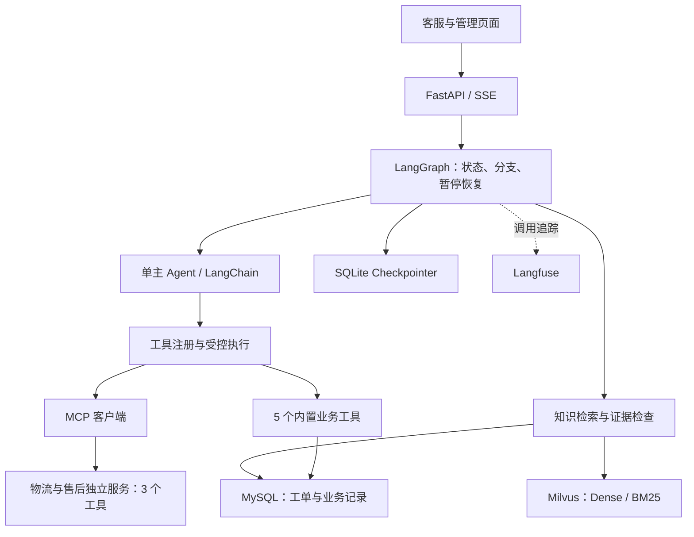

# 客小助 · CareMate

**可控式 Workflow–Agent 智能客服系统**

面向电商场景，支持商品与政策问答、订单物流查询、退换货咨询、选单与工单确认，以及未解决问题的归集审核。采用 **LangGraph + LangChain + MCP**：必要步骤由程序编排，单主 Agent 根据工具回执继续决策，知识回答提供来源引用。

[功能演示](docs/demo/README.md) · [工具执行设计](docs/engineering/tool-execution.md) · [架构与源码](docs/architecture/README.md) · [实验报告](docs/evaluation/README.md) · [部署](DEPLOY.md)

## 实验摘要

| 结果 | 统计条件 | 依据 |
| --- | --- | --- |
| **98.4%** 分组 Recall@5 | 2026-10-11；52 知识片段，300 题中 240 道可答题；混合检索＋重排 | [RAG 四策略](docs/evaluation/rag/README.md) |
| **93.7%** 答案要点覆盖 | 同一 RAG 实验，模型裁判评价标准要点覆盖 | [结果与问题设计](docs/evaluation/rag/README.md) |
| **70/72** 连续任务通过 | 2026-10-27/28；24 段合成会话，每段三问；开发验证版摘要＋滑窗＋回查 | [上下文四方法](docs/evaluation/context/README.md) |

以上为固定内部实验结果。检索命中、答案覆盖与连续任务是不同指标；上下文开发验证版与公开应用的对应关系见[版本表](docs/architecture/context-engineering.md#版本与材料)。

## 系统架构



订单、商品、物流及部分售后使用模拟数据；工单确认后写入 MySQL。退款工具展示申请表单，支付退款由外部业务流程处理。MCP 可发现的业务工具正常情况下共 8 个，实际数量取决于服务可达性。

## 一条请求如何执行


五条业务路线由代码规定；Agent 循环中由模型选择工具。创建工单会暂停等待确认。确定性节点也可以调用 LLM，例如政策检索前的查询扩写。

## 设计决策、实现与验证

| 工程问题 | 设计与源码 | 验证材料 |
| --- | --- | --- |
| 如何保证必要业务顺序？ | [图编排](app/graph/build.py)、[五路映射](app/graph/routing.py) | [路由测试](tests/graph/test_routing.py) |
| 如何组织消息、固定字段与工具请求？ | [提示词](app/core/prompts.py)、[结构化封装](app/core/llm.py)、[主 Agent](app/graph/nodes.py) | [四组件说明](docs/architecture/workflow-and-agent.md) |
| 模型请求怎样进入受控执行？ | [注册表](app/tools/registry.py)、[执行引擎](app/tools/engine.py) | [执行测试](tests/tools/test_engine.py)、[确认与取消](tests/graph/test_ch08_confirm_ticket.py) |
| 如何同时覆盖口语与精确型号？ | [混合检索与重排](app/core/retrieval.py) | [五模型选型](docs/evaluation/embedding/README.md)、[四策略比较](docs/evaluation/rag/README.md) |
| 如何判断检索材料足够作答？ | [最高重排分](app/core/confidence.py)、[语义自检](app/core/selfcheck.py) | [证据门控说明](docs/architecture/rag-and-confidence.md) |
| 如何保留长对话中的更正与限制？ | [摘要、窗口与回查](docs/architecture/context-engineering.md) | [任务设计与四方法结果](docs/evaluation/context/README.md) |
| 如何把未解决问题用于补知识？ | [标准化与归并](app/core/flywheel.py)、[人工核准](app/api/review.py) | [知识反馈与主题分类](docs/architecture/feedback-and-classifier.md) |

## 功能演示

| 输入 | 观察重点 | 操作说明 |
| --- | --- | --- |
| `订单 1001 的物流到哪了？` | 订单号 → 物流单号 → MCP 物流回执 | [物流工具组合](docs/demo/README.md#物流工具组合) |
| `我要退货，但我不记得订单号了。` | 选单中断、恢复、政策检索 | [退货选单](docs/demo/README.md#退货选单) |
| `你们卖活体宠物吗？` | 路由、证据检查与回答依据 | [证据不足场景](docs/demo/README.md#证据不足场景) |
| `帮我建售后工单，猫砂盆漏电，需要人工处理。` | 工单预览、取消与写入控制 | [工单确认与取消](docs/demo/README.md#工单确认与取消) |

场景表描述预期行为；真实模型的具体工具顺序以现场回执为准。[运行准备与故障处理](docs/demo/runbook.md)提供操作步骤，[核心回归记录](docs/demo/assets/core-tests-20261103.md)提供隔离测试证据。

## 本地运行

需要 Python 3.12+（可由 uv 管理）、uv、Docker Compose。Makefile 工作流还需要 Make 与 Bash；Windows 可使用 Git for Windows、GNU Make 和项目启动脚本。模型聊天、嵌入、重排服务分别在配置中设置。

1. 复制 `.env.example` 为 `.env`，填写自己的服务配置。
2. 依照 [DEPLOY.md](DEPLOY.md) 安装依赖、启动容器并初始化业务与知识数据。
3. Windows 可运行 `Start-CareMate.cmd`；使用 Make 的环境可运行下面的基础启动命令。

```bash
uv sync
cp .env.example .env
# 编辑 .env 后再启动
docker compose up -d
make seed
make dev
```

基础服务启动后，按部署说明继续完成知识入库和向量化；主题分类功能还需准备分类器权重与推理服务。

| 页面/服务 | 默认本机地址 |
| --- | --- |
| 客服聊天 | http://localhost:8000/ |
| 管理入口 | http://localhost:8000/admin |
| 知识库 | http://localhost:8000/kb |
| 待审队列 | http://localhost:8000/review |
| 观测与成本 | http://localhost:8000/observability |
| 主题分类验收 | http://localhost:8000/acceptance |
| Langfuse（单独启动） | http://localhost:3000/ |

上表为本机运行地址。Compose 提供开发环境，外部部署的凭据、鉴权与网络设置见部署说明。


## 验证与实现范围

[核心回归 CI](.github/workflows/ci.yml)运行无需真实密钥、MySQL 或 Milvus 的精选测试；完整测试及真实模型评测按[部署说明](DEPLOY.md)准备依赖。测试替身验证控制逻辑，真实服务表现通过独立 Demo 和评测记录核对。

| 材料 | 状态 |
| --- | --- |
| Workflow、8 个业务工具、MCP 接入与工单确认 | 公开应用源码及对应测试 |
| 滚动摘要、滑窗、指代补全 | 公开基础实现 |
| BM25 历史原文回查及四方法结果 | 开发验证版；提供[代码摘录](docs/architecture/code-excerpts/context-recall.md)，完整接线尚未同步公开应用 |
| Agent Skills、Prompt 统一回归、按意图工具白名单 | 后续方向，当前不作为已实现能力 |

基础工程来源、变更材料和发布范围见[项目来源](docs/PROJECT-SOURCES.md)与[变更依据](docs/CONTRIBUTIONS.md)。本仓库的架构说明描述系统行为，提交记录描述具体变更。
