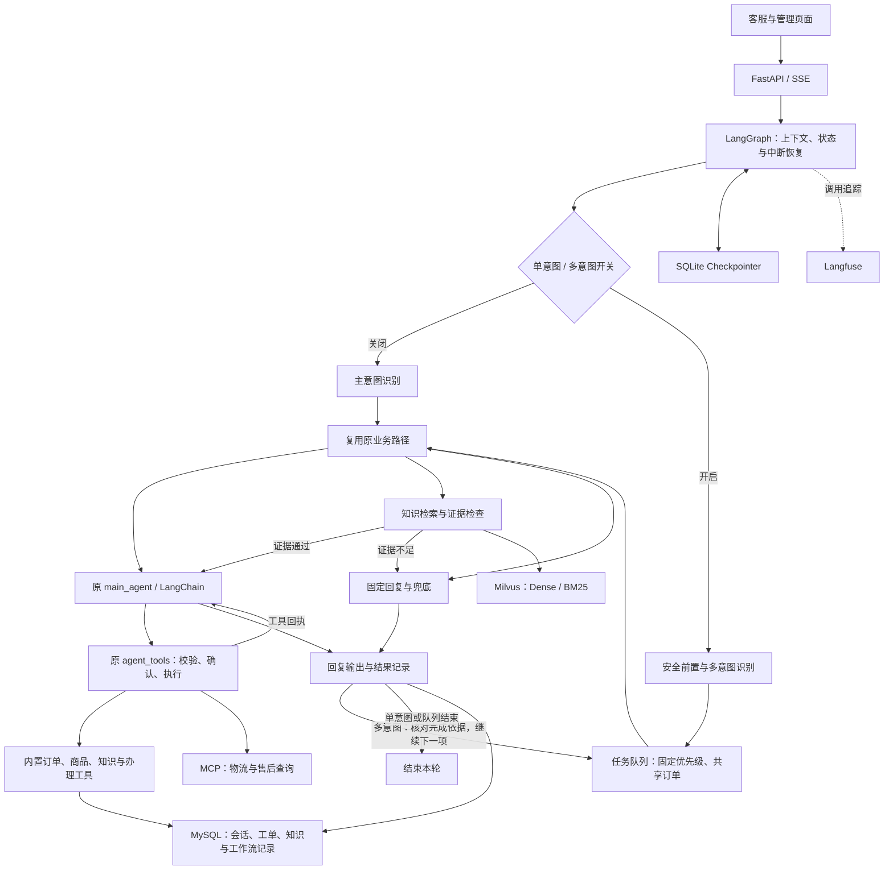

# 客小助 · CareMate

**可控式 Workflow–Agent 智能客服系统**

面向电商场景，支持商品与政策问答、订单物流查询、退换货咨询、选单与工单确认，以及未解决问题的归集审核。采用 **LangGraph + LangChain + MCP**：必要步骤由程序编排，单主 Agent 根据工具回执继续决策，知识回答提供来源引用。

[功能演示](docs/demo/README.md) · [工具执行设计](docs/engineering/tool-execution.md) · [架构与源码](docs/architecture/README.md) · [实验报告](docs/evaluation/README.md) · [部署](DEPLOY.md)

## 模块导航

按“流程 → 多意图调度 → 知识检索 → 上下文 → 知识反馈”了解系统；各模块都提供源码入口和相关结果。

| 顺序 | 内容 | 入口 |
| --- | --- | --- |
| 1 | Workflow、四个组件与工具执行 | [架构详解](docs/architecture/workflow-and-agent.md) · [源码索引](docs/architecture/source-map.md) |
| 2 | 多意图任务拆分、优先级调度与中断续办 | [多意图调度器设计](docs/architecture/multi-intent-scheduler.md) |
| 3 | 知识存储、分块、Embedding选型与混合检索 | [RAG与证据评估](docs/architecture/rag-and-confidence.md) |
| 4 | 滚动摘要、滑窗、原文回查及连续任务 | [上下文工程](docs/architecture/context-engineering.md) |
| 5 | 问题归并、人工核准与主题分类 | [知识反馈](docs/architecture/feedback-and-classifier.md) |
| 6 | 实验结果、问题设计与统计方法 | [实验与评估](docs/evaluation/README.md) |
| 7 | 环境准备与功能页面 | [部署说明](https://github.com/Orange-ui0811/caremate/blob/main/DEPLOY.md) · [架构导航](docs/architecture/README.md) |

## 实验摘要

| 结果 | 统计条件 | 依据 |
| --- | --- | --- |
| **98.4%** 分组 Recall@5 | 2026-10-11；52 知识片段，300 题中 240 道可答题；混合检索＋重排 | [RAG 四策略](docs/evaluation/rag/README.md) |
| **93.7%** 答案要点覆盖 | 同一 RAG 实验，模型裁判评价标准要点覆盖 | [结果与问题设计](docs/evaluation/rag/README.md) |
| **70/72** 连续任务通过 | 2026-10-27/28；24 段合成会话，每段三问；开发验证版摘要＋滑窗＋回查 | [上下文四方法](docs/evaluation/context/README.md) |

以上为固定内部实验结果。检索命中、答案覆盖与连续任务是不同指标；上下文开发验证版与公开应用的对应关系见[版本表](docs/architecture/context-engineering.md#版本与材料)。

## 系统架构



订单、商品、物流及部分售后使用模拟数据；工单确认后写入 MySQL。退款工具展示申请表单，支付退款由外部业务流程处理。MCP 可发现的业务工具正常情况下共 8 个，实际数量取决于服务可达性。

## 单意图基线：一条请求如何执行


五条业务路线由代码规定；Agent 循环中由模型选择工具。创建工单会暂停等待确认。确定性节点也可以调用 LLM，例如政策检索前的查询扩写。

## 设计决策、实现与验证

| 工程问题 | 设计与源码 | 验证材料 |
| --- | --- | --- |
| 如何保证必要业务顺序？ | [图编排](app/graph/build.py)、[五路映射](app/graph/routing.py) | [路由测试](tests/graph/test_routing.py) |
| 如何组织消息、固定字段与工具请求？ | [提示词](app/core/prompts.py)、[结构化封装](app/core/llm.py)、[主 Agent](app/graph/nodes.py) | [四组件说明](docs/architecture/workflow-and-agent.md) |
| 模型请求怎样进入受控执行？ | [注册表](app/tools/registry.py)、[执行引擎](app/tools/engine.py) | [执行测试](tests/tools/test_engine.py)、[确认与取消](tests/graph/test_ch08_confirm_ticket.py) |
| 如何同时覆盖口语与精确型号？ | [混合检索与重排](app/core/retrieval.py) | [五模型选型](docs/evaluation/embedding/README.md)、[四策略比较](docs/evaluation/rag/README.md) |
| 如何判断检索材料足够作答？ | [最高重排分](app/core/confidence.py)、[语义自检](app/core/selfcheck.py) | [证据门控说明](docs/architecture/rag-and-confidence.md) |
| 如何保留长对话中的更正与限制？ | [摘要、窗口与回查](docs/architecture/context-engineering.md) | [任务设计与四方法结果](docs/evaluation/context/README.md) |
| 如何把未解决问题用于补知识？ | [标准化与归并](app/core/flywheel.py)、[人工核准](app/api/review.py) | [知识反馈与主题分类](docs/architecture/feedback-and-classifier.md) |

## 功能演示

| 输入 | 观察重点 | 操作说明 |
| --- | --- | --- |
| `订单 1001 的物流到哪了？` | 订单号 → 物流单号 → MCP 物流回执 | [物流工具组合](docs/demo/README.md#物流工具组合) |
| `我要退货，但我不记得订单号了。` | 选单中断、恢复、政策检索 | [退货选单](docs/demo/README.md#退货选单) |
| `你们卖活体宠物吗？` | 路由、证据检查与回答依据 | [证据不足场景](docs/demo/README.md#证据不足场景) |
| `帮我建售后工单，猫砂盆漏电，需要人工处理。` | 工单预览、取消与写入控制 | [工单确认与取消](docs/demo/README.md#工单确认与取消) |

场景表描述预期行为；真实模型的具体工具顺序以现场回执为准。[运行准备与故障处理](docs/demo/runbook.md)提供操作步骤，[核心回归记录](docs/demo/assets/core-tests-20261103.md)提供隔离测试证据。

## 本地运行

需要 Python 3.12+（可由 uv 管理）、uv、Docker Compose。Makefile 工作流还需要 Make 与 Bash；Windows 可使用 Git for Windows、GNU Make 和项目启动脚本。模型聊天、嵌入、重排服务分别在配置中设置。

1. 复制 `.env.example` 为 `.env`，填写自己的服务配置。
2. 依照 [DEPLOY.md](DEPLOY.md) 安装依赖、启动容器并初始化业务与知识数据。
3. Windows 可运行 `Start-CareMate.cmd`；使用 Make 的环境可运行下面的基础启动命令。

```bash
uv sync
cp .env.example .env
# 编辑 .env 后再启动
docker compose up -d
make seed
make dev
```

基础服务启动后，按部署说明继续完成知识入库和向量化；主题分类功能还需准备分类器权重与推理服务。

| 页面/服务 | 默认本机地址 |
| --- | --- |
| 客服聊天 | http://localhost:8000/ |
| 管理入口 | http://localhost:8000/admin |
| 知识库 | http://localhost:8000/kb |
| 待审队列 | http://localhost:8000/review |
| 观测与成本 | http://localhost:8000/observability |
| 主题分类验收 | http://localhost:8000/acceptance |
| Langfuse（单独启动） | http://localhost:3000/ |

上表为本机运行地址。Compose 提供开发环境，外部部署的凭据、鉴权与网络设置见部署说明。


## 验证与实现范围

[核心回归 CI](.github/workflows/ci.yml)运行无需真实密钥、MySQL 或 Milvus 的精选测试；完整测试及真实模型评测按[部署说明](DEPLOY.md)准备依赖。测试替身验证控制逻辑，真实服务表现通过独立 Demo 和评测记录核对。

| 材料 | 状态 |
| --- | --- |
| Workflow、8 个业务工具、MCP 接入与工单确认 | 公开应用源码及对应测试 |
| 滚动摘要、滑窗、指代补全 | 公开基础实现 |
| BM25 历史原文回查及四方法结果 | 当前分支已接入历史回查；四方法结果仍对应各自冻结版本，见[上下文工程](docs/architecture/context-engineering.md) |
| 多意图当前任务工具范围 | 已实现，见[多意图调度器设计](docs/architecture/multi-intent-scheduler.md)；Agent Skills与Prompt统一回归仍为后续方向 |

基础工程来源、变更材料和发布范围见[项目来源](docs/PROJECT-SOURCES.md)与[变更依据](docs/CONTRIBUTIONS.md)。本仓库的架构说明描述系统行为，提交记录描述具体变更。

## 客服会话上下文（默认方案）

默认使用滚动摘要、近期原文滑窗及相关原文回查，仍沿用 `CONTEXT_POLICY=legacy` 的节点输入方式：

```dotenv
CONTEXT_POLICY=legacy
SUMMARY_TRIGGER_MESSAGES=30
CONTEXT_WINDOW_TURNS=3
CONTEXT_WINDOW_MAX_TOKENS=3000
CONTEXT_LEGACY_RECALL_ENABLED=true
CONTEXT_LEGACY_RECALL_MODE=all_visible_neighbors
```

摘要边界之后累计 30 条消息时，在回复结束后后台用“旧摘要＋新滑出窗口的原文”更新摘要，
成功后保留最近 3 轮原文；两次维护之间原文会继续增长，并非每轮固定只看 3 轮。
指代消解和意图识别保持最近 6 条历史消息的截取，回答保持原有 3,000 估算 Token 原文窗；
该值不包含摘要、回查和其他提示内容，不是整个模型请求的硬上限。

回查只使用已核实归属的当前会话、当前消息水位之前的原文，以当前用户原话对历史用户消息做 BM25，
取正分 Top3 命中问答及各自前后相邻问答，合并后按消息 ID 与该节点已有原文去重，保留角色和来源引用。
回查不额外调用模型，不改变知识检索、工具执行与提交确认规则；历史客服说法不能充当本轮业务回执。
完整对话仍保存在数据库，旧会话下次请求即可用新回查；已有摘要不批量重写，下次符合条件时按新保留轮数更新。

配置修改后需重启服务。设 `CONTEXT_WINDOW_TURNS=8`、`CONTEXT_LEGACY_RECALL_ENABLED=false`
可回退旧方案。内部合成对照及成本口径见
[四方法报告与题目设计](docs/evaluation/context/README.md)。

## 结构化来源状态（可选策略）

`CONTEXT_POLICY=source` 是另一套可选来源状态策略，不是默认方案的回查开关。切换前先完成独立对照，
再在本地 `.env` 设置以下非敏感项并重启服务：

```dotenv
CONTEXT_POLICY=source
CONTEXT_RECOVERY_TOOLS_ENABLED=true
CONTEXT_STATE_BUDGET=9800
CONTEXT_INPUT_BUDGET=16000
CONTEXT_OUTPUT_BUDGET=8192
CONTEXT_COREF_BUDGET=4000
CONTEXT_INTENT_BUDGET=1800
CONTEXT_RECALL=conditional
CONTEXT_SUMMARY_TRIGGER_TOKENS=12000
CONTEXT_SUMMARY_TARGET_TOKENS=1000
```

`source` 使用稳定消息ID、原文位置和哈希，维护对象候选、更正及仍有效的限制；
这些状态仅是有来源的用户陈述，不替代订单归属核验、实时业务结果或提交确认。
指代、意图、检索与回答按节点装配同一版本的状态；完整模型请求另有预算检查。
预算均为启发式估算，不是供应商Tokenizer或模型上下文上限。

开启 source 后启动时只新增 `context_*` 六张表，不清空原聊天。快照写入使用版本比较，
历史按消息水位读取；工具回执在格式化前保存，来源读取检查会话归属。
`CONTEXT_RECOVERY_TOOLS_ENABLED=true` 允许模型通过只读工具按需取回本会话片段，
片段会发给配置的模型服务，可能包含订单或客户信息；应在获得相应授权后开启。
工具成功但回执保存失败时保留原结果，不重试已完成的写操作。

分段摘要只压缩固定的早期消息范围，保留近期原文；后台任务不能覆盖当前任务状态。
超大工具结果仅在回执保存成功且回读工具开启时外置。记忆无法核实或必要证据超预算，
会明确降级，日志区分预算/来源失败与知识库证据不足。
状态提取仍限于明确表达；快照每轮重建，尚未验证大规模历史的生产吞吐。

新评测入口 `python -m scripts.eval_context_state_v2 --help`，先用 `--preflight`
验证接口，再用 `--prepare` 冻结源码、数据、模型路由和协议，最后运行真实API。
V2 对全部组统一强制结构化计划，包含可触发 12,000 估算 Token 摘要阈值的长会话。
源码仍与冻结版本一致时可用 `--audit` 离线复算；修改源码后应使用独立的冻结副本。
旧报告及其源码快照保留，新评分不覆盖旧分数。合成测试不等于线上准确率，
检查点回放、连续回复回填和真实Workflow验证分别报告，维护与重试成本计入各自口径。

2026-10-27 的 [正式对照](data/ch07/context-state/20261027-gitee-reserved-v2-1/AUDITED_REPORT.md)
与 [隔离复算](data/verification/context-offline-replay-20261027/formal-replay/replay_report.json)
已完成；新策略保持可选，默认仍为 legacy。完整候选在该合成集上规则通过 67/72，
旧方案为 61/72，但包含维护的总 Token 增加 37.3%，不足以证明稳定优势或整体降本。
设计、预算、已知边界及验收口径见 [上下文管理说明](docs/architecture/context-engineering.md)。

## 目录

```text
app/api/          HTTP 与 SSE 接口
app/graph/        状态、节点、路由和图运行
app/core/         模型、检索、上下文、反馈与观测
app/tools/        工具注册、实现、MCP 客户端与执行引擎
app/db/           数据模型与仓储
app/static/       客服与管理页面
mcp_servers/      独立物流和售后服务
scripts/          初始化、评估、训练与报表
sql/              数据库初始化与迁移
tests/            测试与测试数据
docs/architecture/   架构说明及源码索引
```

