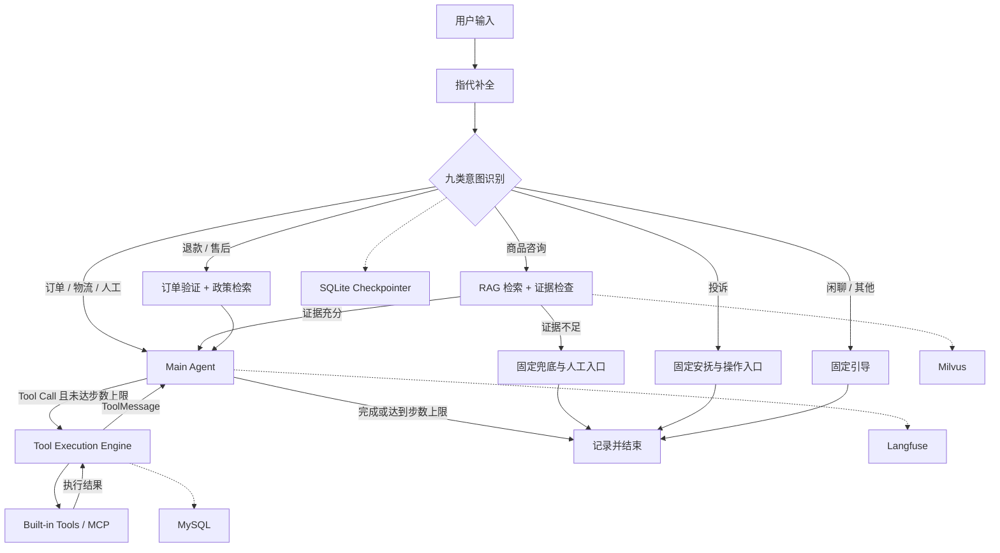

# CareMate

### Controllable Workflow-Agent for E-commerce Support

**Stateful Orchestration · Governed Tool Execution · Evidence-grounded RAG · Evaluation**

CareMate 是面向电商售后场景的 AI Agent 工程实践项目。基于 **LangGraph + LangChain + MCP**，结合确定性业务工作流与单主 Agent 的动态工具调用，实现知识问答、订单物流查询、售后处理、人工确认及知识反馈。

**Tech Stack：** Python · FastAPI · LangGraph · LangChain · Milvus · MCP · MySQL · Langfuse

[Architecture](#02--系统架构) · [Engineering Highlights](#03--engineering-highlights) · [Demo](#04--demo--reproduction) · [Evaluation](docs/evaluation/README.md) · [Quick Start](DEPLOY.md)

---

## 01 / 项目价值

项目重点解决三个实际工程问题：

**Agent 可控执行**

对于订单归属、政策检索和工单创建等操作，不能完全依赖模型自主规划。系统采用确定性 Workflow + 单主 Agent 的混合架构，将必要步骤放入 LangGraph，将动态工具组合交给模型，并由后端校验和授权执行。

**可靠的知识增强问答**

电商客服同时面临口语表达、精确商品型号及复杂政策条件。系统构建 Dense + BM25 混合检索，通过 RRF 融合、Cross-Encoder Rerank 和生成前证据充分性检查，降低缺乏依据的回答进入生成流程的风险。

**长对话上下文管理**

针对历史订单更正、远距离指代与多对象切换，公开基础应用采用滚动摘要和近期原文窗口；开发验证版进一步实验基于 BM25 的历史会话原文回查，相对完整历史输入控制成本并恢复关键历史依据。

此外，系统包含统一工具注册与执行引擎、状态持久化与人工确认、Langfuse 运行追踪及人工审核驱动的知识更新。

---

## 02 / 系统架构

系统采用 **Workflow + Single-Agent** 混合架构：

- 确定性 Workflow 保证必要业务顺序。
- 主 Agent 根据上下文和工具回执动态选择下一步。
- 统一工具执行层负责参数校验、权限检查与结果回传。



**主要组件**

| Component | Responsibility |
| --- | --- |
| LangGraph | 状态、意图路由、业务流程与中断恢复 |
| LangChain | Prompt、模型交互、结构化输出与工具绑定 |
| MCP | 独立业务工具发现和调用 |
| Milvus | Dense / BM25 混合检索 |
| MySQL / SQLite | 业务持久化与 Graph Checkpoint |
| Langfuse | Agent 执行追踪与用量分析 |

### Key Results

| **98.4%** | **93.7%** | **70/72** | **8** |
| :---: | :---: | :---: | :---: |
| RAG Grouped Recall@5 | Answer Point Coverage | Context Tasks Passed | Defined Business Tools |
| [RAG Evaluation](docs/evaluation/rag/README.md) | [Answer Evaluation](docs/evaluation/rag/README.md) | [Context Evaluation](docs/evaluation/context/README.md) | [Tool Registry](app/tools/registry.py) |

以上为对应版本的内部实验及工具定义结果：

- RAG：52 个知识片段、300 道题，其中 240 道可答题参与主要质量统计；答案要点覆盖使用模型裁判。
- Context：24 段内部合成会话，每段三次连续追问，共 72 次任务判定；70/72 来自开发验证版本。
- 工具：5 个内置工具、3 个 MCP 工具；实际可用数量取决于服务发现状态。

不将历史内部实验结果解释为线上生产准确率。

---

## 03 / Engineering Highlights

### 01. Stateful Workflow-Agent Orchestration

**核心设计：** 将确定性业务约束与 Agent 动态决策解耦。

基于 LangGraph StateGraph 构建九类意图、五条业务处理路径。使用 Conditional Edges 控制必经流程，以 Function Calling 与 ToolMessage 构建 ReAct 式工具循环；结合 Checkpointer 和 interrupt/resume 支持选单、工单确认与执行恢复。

**Implementation & Evidence**

[Graph Builder](app/graph/build.py) · [State](app/graph/state.py) · [Routing Tests](tests/graph/test_routing.py)

### 02. Governed Tool Execution

**核心设计：** 将工具选择权交给模型，将执行控制权保留在后端。

通过 ToolSpec/Registry 统一管理内置工具与 MCP 动态发现；执行层提供 JSON Schema 校验、可信身份参数注入、超时控制、有限重试、写操作确认及调用审计。工具执行结果通过 ToolMessage 回传模型。

写操作不自动重试，工单创建需要用户确认；退款工具转为前端申请表单。当前 `WRITE_TOOLS` 仅登记 `create_ticket`，其余已发现工具默认按读处理，尚无通用默认拒绝或按意图白名单；Checkpointer 不保证外部写入 Exactly-Once。详见[执行设计](docs/engineering/tool-execution.md)。

**Implementation & Evidence**

[Registry](app/tools/registry.py) · [Execution Engine](app/tools/engine.py) · [Execution Tests](tests/tools/test_engine.py) · [Human Approval Tests](tests/graph/test_ch08_confirm_ticket.py)

### 03. Hybrid RAG & Evidence Reliability

**核心设计：** 多路召回提高候选覆盖，通过重排和证据检查控制生成依据。

知识入库保留标题路径、句子重叠与表格结构。在线查询采用 BGE-M3 Dense + Milvus BM25 Sparse、RRF 融合和 BGE-Reranker-v2-M3 精排；主知识分支随后通过最高重排分相关性粗筛与生成前证据充分性检查决定是否进入知识回答。相关性分数不代表答案正确概率。

未解决问题及检索快照进入知识反馈流程，经过标准化归并与人工审核后补充知识库。

**Implementation & Evidence**

[Retrieval](app/core/retrieval.py) · [Evidence Confidence](app/core/confidence.py) · [RAG Evaluation](docs/evaluation/rag/README.md)

### 04. Context Engineering & Memory Retrieval

**核心设计：** 利用分层对话记忆，在保留关键历史事实的同时控制上下文成本。

开发验证方案在 Rolling Summary、Sliding Window 基础上加入 BM25-based Conversational Memory Retrieval，通过相关历史问句召回、邻轮扩展和消息 ID 去重，补充摘要遗漏的实体关系、更正及用户限制。

在内部对照实验中，相较摘要＋滑窗基线，任务规则通过率由 **81.9% 提升至 97.2%**；相比完整历史输入，记录的 Token 用量至少降低约 **25.3%**。

新回查组记录 479,290 Token，完整历史为 ≥641,440；完整历史有一次超时缺失 usage，25.3% 按其用量下界保守估算，维护成本已计入。BM25 历史回查的完整应用接线尚未全部同步到公开主分支；该结果属于开发验证版本。

**Implementation & Evidence**

[Context Design](docs/architecture/context-engineering.md) · [Recall Excerpts](docs/architecture/code-excerpts/context-recall.md) · [Context Evaluation](docs/evaluation/context/README.md)

### Source & Evidence Navigator

| Engineering Decision | Source Code | Verification |
| --- | --- | --- |
| Workflow-Agent 编排 | [build.py](app/graph/build.py) | [路由测试](tests/graph/test_routing.py) |
| 工具治理与人工确认 | [engine.py](app/tools/engine.py) | [执行测试](tests/tools/test_engine.py) |
| RAG 与证据门控 | [retrieval.py](app/core/retrieval.py) | [RAG 四策略](docs/evaluation/rag/README.md) |
| 分层对话记忆 | [Context Design](docs/architecture/context-engineering.md) | [上下文实验](docs/evaluation/context/README.md) |
| 知识反馈与更新 | [flywheel.py](app/core/flywheel.py) | [反馈设计](docs/architecture/feedback-and-classifier.md) |

---

## 04 / Demo & Reproduction

以下场景用于验证系统的主要业务能力。真实模型的工具选择和执行顺序以实际运行结果为准。

| Scenario | Example Input | What to Verify |
| --- | --- | --- |
| 商品知识问答 | `MH-LP100 的废砂盒多久倒一次？` | 检索证据、回答条件、引用来源 |
| MCP 物流查询 | `订单 1001 的物流到哪了？` | 订单查询、物流单号、MCP 工具回执 |
| 人工选单 | `我要退货，但忘记订单号了` | interrupt、订单选择、resume |
| 工单确认 | `帮我建售后工单，猫砂盆漏电，需要人工处理。` | 工单预览、确认或取消、执行记录 |

### Demo Walkthrough

[完整演示指南](docs/demo/README.md) · [运行手册](docs/demo/runbook.md) · [工具执行设计](docs/engineering/tool-execution.md)

当前公开材料提供文字操作指南和[隔离回归记录](docs/demo/assets/core-tests-20261103.md)，尚缺本轮真实客服截图和模型 Trace。后续运行材料需注明代码版本、时间和数据来源；隔离单元测试与真实模型结果分别记录。

### Reproduction

```bash
uv sync
cp .env.example .env
# 配置自己的模型与服务参数
docker compose up -d
```

随后按 [DEPLOY.md](DEPLOY.md) 完成数据库初始化、知识入库、向量化与业务服务启动。

**Evaluation Reports**

[RAG](docs/evaluation/rag/README.md) · [Embedding](docs/evaluation/embedding/README.md) · [Context](docs/evaluation/context/README.md)

---

## 05 / Limitations & Project Provenance

### Current Limitations

- 当前为单主 Agent，并非 Multi-Agent 协作架构。
- 订单、物流及部分业务数据采用模拟实现。
- RAG 实验使用小规模内部知识库，尚未证明大规模生产表现。
- BM25 历史原文回查的完整应用接线尚未全部公开。
- 工具权限声明、业务写入幂等及持续评测体系仍有改进空间。

### Future Work

Agent Skills 模块化能力封装、Prompt Golden Set 自动回归、更严格的工具权限治理、独立大规模 RAG 评测，以及持续完善上下文记忆与执行恢复。

### Project Provenance

本项目包含对已有客服工程的学习、复现与扩展。原始工程公开再分发授权仍待核实，仓库尚无覆盖整个工程的根级 LICENSE；素材许可仅适用于对应素材。基础工程来源与可核验变更记录见：

[Project Sources](docs/PROJECT-SOURCES.md) · [Contributions](docs/CONTRIBUTIONS.md) · [Architecture Docs](docs/architecture/README.md)

历史实验、公开源码与开发验证版本分别记录，不将未实现能力或未经验证的个人贡献列为既有成果。
