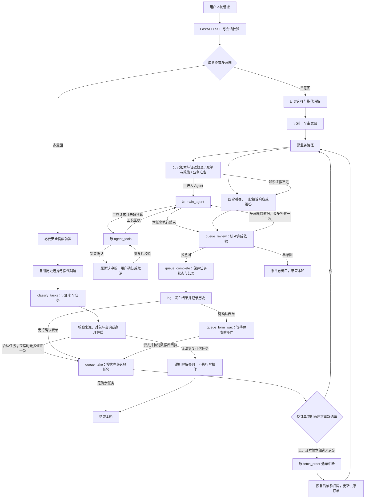
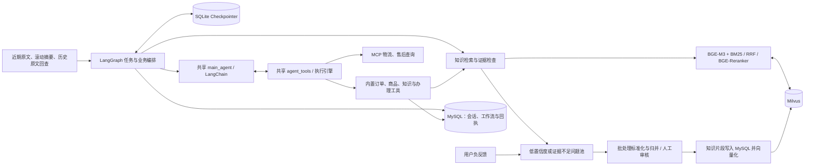
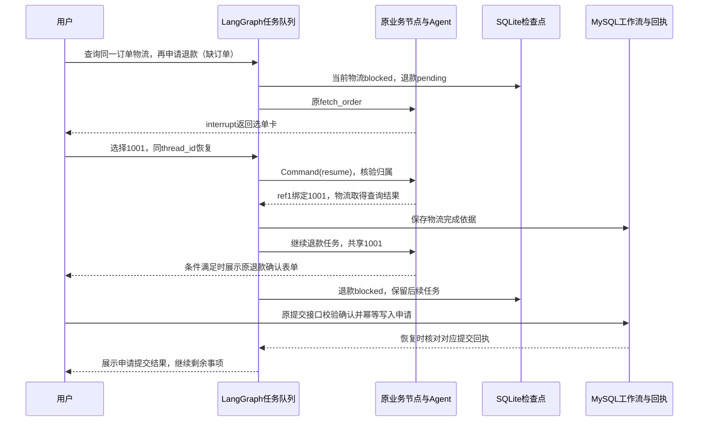
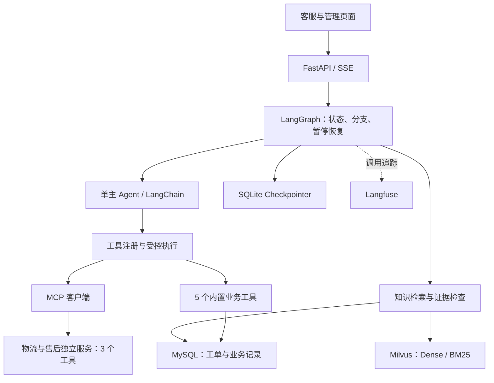
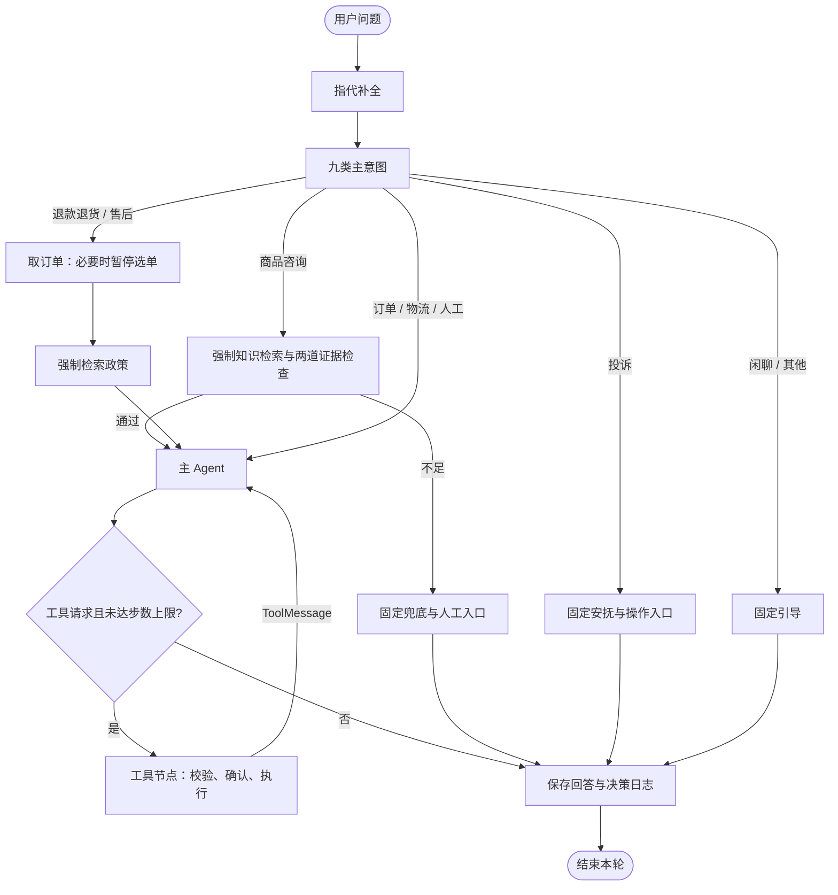

# 客小助 · CareMate

**可控式 Workflow–Agent 智能客服系统**

面向电商场景，支持商品与政策问答、订单物流查询、退换货咨询、选单与工单确认，以及未解决问题的归集审核。采用 **LangGraph + LangChain + MCP**：必要步骤由程序编排，单主 Agent 根据工具回执继续决策，知识回答提供来源引用。

[功能演示](docs/demo/README.md) · [工具执行设计](docs/engineering/tool-execution.md) · [架构与源码](docs/architecture/README.md) · [实验报告](docs/evaluation/README.md) · [基础部署说明](https://github.com/Orange-ui0811/caremate/blob/eac8bf2d3488731f1c6391017ddfac3aa0935247/DEPLOY.md)

## 当前分支：共享 Agent 的多意图调度 v4

本分支 `feature/multi-intent-shared-agent-v4` 在单意图工作流外增加**任务识别、共享对象、固定优先级串行调度、完成依据检查和中断续办**。业务执行仍复用原 `main_agent`、`agent_tools`、检索、取单及确认机制，没有为每个意图另建 Agent 或业务执行器。

本文按业务源码 [`8911379`](https://github.com/Orange-ui0811/caremate/commit/8911379fa4d30a6ba318270351afa35cda680c24) 整理，文档更新于 **2026-11-06**。**已有150题全量结果属于较早的冻结版本 `91dd05b`，不代表 `8911379` 已完成全量复测。** 后续修复与验证范围在下方单独列出。

[架构与基线对比](#multi-architecture) · [LangGraph 调度原理](#multi-scheduling) · [已有评测结果](#multi-evaluation) · [面试问答与边界](#multi-interview) · [本地启用](#multi-enable)

<a id="multi-architecture"></a>

### 架构：外层任务循环，内层复用原 Agent



选单与工具确认恢复的是相应中断节点；图中的箭头不代表重新执行整个业务路径。一般投诉仍可以走固定响应和操作入口；**明确要求登记投诉或人工跟进的办理任务**由规划映射到原工单路径，不把所有抱怨都自动变成建单请求。

| 对比点 | 单意图基线 | 当前多意图 v4 |
| --- | --- | --- |
| 识别结果 | 一个主意图，进入一条主路径 | 多个任务，保留原文、对象与咨询/办理性质 |
| 执行核心 | 原 `main_agent` 与 `agent_tools` | 同一套 Agent 与工具，逐项调用 |
| 复合问题 | Agent 可能在一条路径中顺带处理多个问题 | 显式保存待办清单、当前项和剩余项 |
| 订单与结果 | 原路径获取订单与工具结果 | 同组共享已核验订单；可复用同轮成功只读回执 |
| 中断 | 保存当前路径的执行现场 | 同时保留当前任务和其他未完成任务 |
| 完成判定 | 原流程收敛 | 再检查对应查询、确认或提交回执，有限补做 |
| 回复 | 原流式回答与操作卡 | 查询/知识保留流式；办理文字按确认卡、真实回执发布 |

上下文、RAG 和工具服务仍是共享能力：



知识路径的第一道检查为**最终候选最高重排分**，第二道为生成前证据充分性检查；该分数不是答案正确概率。这次多意图改造没有调整检索算法、置信度阈值或证据放行规则。MySQL 保存业务与维护记录，SQLite 检查点保存图执行现场，Milvus 负责知识检索。

<a id="multi-scheduling"></a>

### 调度原理：用 LangGraph 组成可恢复的串行循环

**1. State 保存任务现场。** `ConversationState` 中的 `task_plan` 保存任务字典，`active_task` 指向当前项，`queue_orders` 按 `order_ref` 保存共享订单；`messages` 继续使用 `add_messages` 合并消息。任务还有稳定 `task_id`、执行结果、等待原因、修正次数，办理时保留稳定操作标识。

下面仅为状态结构示意；两项都来自同一句“查询这单物流并申请退款”，因此经过校验后共享对象：

```json
{
  "active_task": "0",
  "task_plan": {
    "0": {"intent": "物流", "order_ref": "ref1", "order_id": null, "status": "blocked", "wait_reason": "select_order"},
    "1": {"intent": "退款退货", "action": "request", "order_ref": "ref1", "order_id": null, "status": "pending"}
  },
  "queue_orders": {}
}
```

**2. 模型识别，程序调度。** 正常一轮执行一次多任务识别；仅结构或来源等校验失败时允许一次规划修正。每项保留 `source`、`query`、`action`、`order_ref`，服务端校验原文来源和订单归属。合法独立事项可以保留，不合法事项不能静默执行写操作。`queue_take` 从 `pending` 中取优先级最小者，同优先级按规划列表顺序处理，并设置原节点读取的 `intent`、`resolved_query`、`order_id` 等字段。

| 优先级 | 当前任务 |
| --- | --- |
| 前置 | 必要的安全提醒，先于业务等待送达 |
| 0 | 订单查询 |
| 1 | 物流查询 |
| 2 | 商品咨询、售后、退款资格等咨询 |
| 3 | 明确的退款办理 |
| 4 | 人工/投诉相关任务 |
| 5 | 其他任务 |

这是当前代码的意图优先级；售后意图固定为2，不是一个覆盖所有业务的通用依赖图。调度器属于本轮业务控制逻辑，不是定时任务系统，也不是让 LLM 自由安排工具顺序。

**3. 条件边复用原路径。** `queue_take → dispatch` 决定进入检索、取单、业务准备或固定回复。Agent 内仍是 `main_agent → agent_tools → main_agent`；外层是 `queue_take → 原路径 → queue_review → queue_complete → log → queue_take`。每项有自己的工具范围，避免提前办理下一项；切换任务不重新分类，也不创建独立会话历史。

**4. 完成必须有依据。** 订单/物流查询检查相应对象的结果；客观未发货或无物流单号可如实说明。申请表单生成只代表待确认；提交完成必须取得当前任务对应的数据库回执。缺依据时，在原步数预算内最多向**同一个 Agent**补充一次提示；仍无结果则记失败，不无限重试。任务使用 `pending / running / blocked / done / failed / cancelled` 六种状态；“取消成功”是否满足评测目标由题目标注决定，不等于提交成功。

**5. 中断先保存任务，恢复不重新规划。** 缺订单时先把当前项保存为 `blocked`，再进入原 `fetch_order` 的 `interrupt()`。使用相同 `thread_id` 和 `Command(resume=...)` 恢复，核验订单归属后，由 `queue_bind_order` 更新同一 `order_ref` 的未完成任务。已明确的历史订单可以继承；本轮明确“先让我选/重新选”时，不能被历史订单覆盖。独立退款、不同订单或有歧义的对象不能擅自共享。



`interrupt` 恢复时，中断节点会重新执行，并在匹配的 `interrupt()` 处取得恢复值，**不是恢复 Python 执行栈到任意代码行**。因此节点中断前的副作用必须可安全重入。Checkpointer 负责恢复现场；外部写入还依赖稳定操作标识和数据库幂等回执，不能宣称检查点提供外部业务 Exactly-Once。

**6. 输出和兼容边界。** 查询、知识回答保留原 `astream → SSE` 与可点击引用。办理任务未经确认卡或回执支持的模型结果文字不直接发布；页面、历史及非流式结果使用对应对外状态。没有新增统一回复生成器。新计划使用 `task_plan_version=4`、`queue_contract_version=1`；旧挂起计划按其版本续办。等待卡片期间新文字请求返回409，不覆盖旧计划；当前不支持自由文字补参或插问调度。

| 查代码时的问题 | 入口 |
| --- | --- |
| 图节点和条件边怎么连接？ | [build.py](app/graph/build.py) |
| 哪些信息保存在图状态？ | [state.py](app/graph/state.py) |
| 如何取任务、限制工具和等待表单？ | [task_queue.py](app/graph/task_queue.py) |
| 如何校验对象、共享订单、核对完成依据？ | [queue_contract.py](app/graph/queue_contract.py)、[order_selection.py](app/core/order_selection.py) |
| 模型如何输出多个意图及原文来源？ | [intent.py](app/core/intent.py)、[task_context.py](app/core/task_context.py) |
| 原 Agent、工具与选单如何执行？ | [nodes.py](app/graph/nodes.py)、[engine.py](app/tools/engine.py) |
| 检查点、SSE与恢复请求如何处理？ | [runtime.py](app/graph/runtime.py) |
| 工单与事件如何防重、保存？ | [workflow.py](app/db/workflow.py)、[actions.py](app/api/actions.py) |

<a id="multi-evaluation"></a>

### 已有评测：150题全量对照与后续专项验证

**数据与方法。** 以原300题知识主题为基础扩展业务场景，冻结150题、五桶各30题，包含132题多任务主集和18题单意图控制集，共321个必需目标。每版本每题只跑一次；本轮新执行修复版150条，复用保存的基线150条和修复前v4的150条轨迹，不补跑基线、不挑最好一轮。三组按 `task-completion-v1` 统一评分，保留C桶、失败和接口异常。

冻结修复版使用 Gitee 的 `DeepSeek-V4-Flash`、`bge-m3`、`bge-reranker-v2-m3`，开启 legacy 历史回查；业务使用合成场景与隔离数据。任务结果结合工具/数据库回执和模型评分，不将裁判当作人工金标准。复核将10条标签与理由冲突的记录转为待定，未改变业务回执结果。

**评分口径。** 场景通过率 = 确认通过场景数 / 150；要求全部必需目标满足且没有确定违规。必需目标完成率 = 确认完成目标数 / 321；回复覆盖率单独统计。待定保留在分母、不算通过，也不冒充确定失败。查询需对应对象结果，办理区分准备、确认入口与实际提交；判断提前宣称成功只使用该句话产生时已有的回执。

| 指标 | 单意图基线（历史轨迹） | 修复前 v4（历史轨迹） | 修复版 `91dd05b`（全量冻结） |
| --- | ---: | ---: | ---: |
| 场景通过率 | 57/150（38.0%） | 77/150（51.3%） | **108/150（72.0%）** |
| 必需目标完成率 | 201/321（62.6%） | 267/321（83.2%） | **273/321（85.0%）** |
| 回复覆盖率 | 229/321（71.3%） | 270/321（84.1%） | 274/321（85.4%） |
| 场景待定 | 6 | 30 | 11 |
| 必需目标待定 | 7 | 6 | 10 |
| 多任务主集通过 | 40/132 | 62/132 | 92/132 |
| 单意图控制集通过 | 17/18 | 15/18 | 16/18 |
| 额外选单（显式订单旧口径） | 3 | 0 | 0 |
| 实际选单总数 | 13 | 29 | 36 |
| 重复工单（计数指标） | 3 | 0 | 0 |
| 未经确认写入 / 错误订单退款 | 0 / 0 | 0 / 0 | 0 / 0 |
| 中位会话耗时 | 29.8秒 | 35.9秒 | 32.3秒 |

“额外选单为0”只针对显式订单旧口径，**不等于所有上下文或重新选单场景都正确**。必要选单增多可以是缺订单流程终于执行了；实际选单总数不能直接作为错误次数。旧运行并发和排队条件不同，耗时不能证明严格性能优势。单意图控制集包含回归，不作为多意图优势的证据。

| 桶（每桶30题） | 检验的情况 | 基线通过 / 待定 | 修复前通过 / 待定 | `91dd05b`通过 / 待定 |
| --- | --- | ---: | ---: | ---: |
| A_explicit | 明确表达多个诉求，是否完整执行 | 19 / 1 | 18 / 5 | 24 / 1 |
| B_binding | 任务与订单绑定、同对象共享和多对象隔离 | 10 / 3 | 17 / 6 | 22 / 1 |
| C_clarification | 缺订单时选单，选择后继续原任务及后续任务 | 1 / 0 | 4 / 7 | 20 / 4 |
| D_recovery | 退款取消、投诉取消、连接重启、物流故障、重复提交，各6题 | 7 / 1 | 16 / 9 | 20 / 2 |
| E_boundary | 单意图控制、拒答与业务边界等 | 20 / 1 | 22 / 3 | 22 / 3 |

该数据集不是原300题的RAG评测，也不是此前120场景三次复测。C桶保留在本次150题结果中；表内“通过 / 待定”是两个计数，剩余为确定失败。

**为什么仍有失败？** 冻结修复版有31个确定失败场景、11个待定场景。退款资格或损坏凭证不足、投诉资料不全仍可能阻止提交；知识证据拒答、来源校验、模型未取必要回执、接口错误等也保留为失败或待定。相对修复前，46题由未通过变为通过，另有12题由通过变为确定失败；单次运行不能把所有变化直接归因于代码。C桶为20通过、6失败、4待定，尚不能声称彻底解决澄清续办。

| 代码版本 | 已有验证 | 可以说明什么 |
| --- | --- | --- |
| [`91dd05b`](https://github.com/Orange-ui0811/caremate/commit/91dd05bd862a4d273b4d17a262f32b6a7a7ac8f8) | 原150题真实接口全量回归一次 | 上述三组对照中的“修复版”指标仅属于此冻结版本 |
| `19795d5` | NB-09一条真实接口定点验证，两笔退款分别确认并取得回执 | 验证该定点，不替换150题中原失败 |
| `d198883` | 89项工程测试通过，另有两套页面验证 | 覆盖完成规则、旧计划、确认与重复提交、流式/历史/引用等；并非89条真实模型对话 |
| [`8911379`](https://github.com/Orange-ui0811/caremate/commit/8911379fa4d30a6ba318270351afa35cda680c24) | 64项专项工程测试通过，3条真实规划探针通过 | 修复明确重选被历史订单覆盖；探针只测规划，业务恢复使用固定模型和隔离数据，未重跑150题 |

最近的专项覆盖“历史1001 → 明确要求重选 → 选择2002 → 关闭/重开SQLite恢复 → 物流取得新回执 → 同组退款确认”等状态迁移，以及否定、条件表达和独立对象隔离。89项与64项来自不同测试集合，**不能相加成153项互不重复测试**。隔离SQLite重开不等于生产断电演练。

可核对的[公开汇总数据与来源指纹](docs/evaluation/multi-intent/results-20261105.json)由本地复核汇总机械提取，保留整数分子、分母、分桶及版本，不包含客户聊天、密钥、运行库或原始模型轨迹。原始材料仍保存在本地：

- `E:\Mewhelp\data\verification\multi-intent-task-completion\20261105-200020\`：`REPORT.md`、`reviewed-summary.json`、`scoring-contract.json`、`runs/`、`judges/`、逐题失败分析。
- `E:\Mewhelp\data\verification\order-reselection\20261105\`：`deployment.json`、`tests-final.xml`、`planner-probe.json`、部署前备份。

仓库内可阅读[150题构造与标注检查](tests/test_orchestration150.py)、[评分规则测试](tests/test_task_completion_scoring.py)、[完成与恢复测试](tests/graph/test_queue_completion.py)、[共享Agent测试](tests/graph/test_shared_agent_queue.py)。公开汇总用于审阅已有结果；精确复现历史实验还需要对应冻结源码、题集与隔离服务，不能仅凭汇总文件重建原始轨迹。

<a id="multi-interview"></a>

### 面试准备：怎么讲设计与结果

**一分钟介绍：** 我在原单Agent客服工作流外增加了多意图任务队列。模型结合已有上下文识别任务及订单对象，服务端校验后按固定优先级串行调用原业务路径。任务进度放进LangGraph State，选单或确认时用interrupt暂停，恢复后共享已核验对象并继续剩余任务。查询完成看对应工具结果，办理完成看确认和提交回执，写入再用稳定操作标识防重。150题内部单次对照中，冻结修复版场景通过率由基线38.0%提升至72.0%，必需目标完成率由62.6%提升至85.0%；最新补丁另做专项验证，还没有全量复测。

| 面试追问 | 回答要点 |
| --- | --- |
| 基线也能回答多个问题，为什么加调度？ | 承认基线Agent可能一次覆盖多个诉求；改造是显式保存每项进度、对象和结果，让中断后仍知道剩余待办，而不是宣称基线完全不支持多意图。 |
| 为什么不用多个Agent？ | 业务共用上下文、订单、检索和工具，同一个Agent已具备执行能力；增加多个Agent会引入重复理解与状态同步。本轮只需要串行协调。 |
| 调度由模型还是代码决定？ | 模型输出任务及对象提议；原文来源、归属、授权边界、优先级与条件边由代码校验和控制。工具选择仍由当前任务内的原Agent完成。 |
| 为什么不用普通for循环？ | 普通循环可以表达顺序，但跨HTTP请求的等待、恢复、状态存储还需自行实现；项目已有LangGraph，因此复用State、检查点与interrupt/resume。 |
| 怎么防止同一订单反复选？ | 同组order_ref共享经过归属校验的订单；明确重选覆盖历史继承。不同对象不共享，选单不等于同意提交。 |
| 怎么防止重复建单？ | 已完成项不重调度；确认和提交使用稳定operation_id与数据库回执防重。检查点本身不能保证外部写入Exactly-Once。 |
| 为什么不让模型说完成就完成？ | 模型文本不是业务事实。查物流需对应查询结果，展示表单不等于提交，申请提交不等于审核通过；按回执核对并限制无依据的办理成功话术。 |
| 怎么证明改进有效？ | 给出相同题集、同一评分口径、固定版本及分桶结果，同时保留失败、待定和控制集退化；单次内部实验支持局部改进，不能证明线上稳定优于基线。 |

**当前边界：** 串行执行遇到选单/确认会暂停整个当前计划，不并行推进其他任务；不支持等待期间自由文字补参或插问。当前状态查询仍可能出现模型复述历史却不调工具，完成检查会记录失败，不能宣称提示词已消除全部此类问题。退款资格、损坏凭证、投诉必填信息等共性业务规则未在本轮放宽。订单/商品及部分外部服务使用模拟数据，工单写MySQL；不实际执行资金退款。

<a id="multi-enable"></a>

### 本地启用与版本兼容

在自己的 `.env` 设置并重启服务：

```dotenv
MULTI_INTENT_SHARED_AGENT_ENABLED=true
MULTI_INTENT_COMPLETION_ENABLED=true
MULTI_INTENT_ENABLED=false
```

前两个开关选择新任务使用v4及完成检查；第三个是无页面覆盖时的默认模式。页面现有“多意图”开关开启时走v4，关闭时走单意图。不要只开启旧的subflows或simple开关来测试本方案。恢复操作沿用挂起计划保存的模式与版本，不会因为切换按钮而迁移执行现场；若旧卡片尚未处理，先完成或取消，再发新一轮测试。

## 原有RAG与上下文实验摘要

| 结果 | 统计条件 | 依据 |
| --- | --- | --- |
| **98.4%** 分组 Recall@5 | 2026-10-11；52 知识片段，300 题中 240 道可答题；混合检索＋重排 | [RAG 四策略](docs/evaluation/rag/README.md) |
| **93.7%** 答案要点覆盖 | 同一 RAG 实验，模型裁判评价标准要点覆盖 | [结果与问题设计](docs/evaluation/rag/README.md) |
| **70/72** 连续任务通过 | 2026-10-27/28；24 段合成会话，每段三问；开发验证版摘要＋滑窗＋回查 | [上下文四方法](docs/evaluation/context/README.md) |

以上为固定内部实验结果。检索命中、答案覆盖与连续任务是不同指标；上下文开发验证版与公开应用的对应关系见[版本表](docs/architecture/context-engineering.md#版本与材料)。

## 系统架构



订单、商品、物流及部分售后使用模拟数据；工单确认后写入 MySQL。退款工具展示申请表单，支付退款由外部业务流程处理。MCP 可发现的业务工具正常情况下共 8 个，实际数量取决于服务可达性。

## 单意图基线：一条请求如何执行



五条业务路线由代码规定；Agent 循环中由模型选择工具。创建工单会暂停等待确认。确定性节点也可以调用 LLM，例如政策检索前的查询扩写。

## 设计决策、实现与验证

| 工程问题 | 设计与源码 | 验证材料 |
| --- | --- | --- |
| 如何保证必要业务顺序？ | [图编排](app/graph/build.py)、[五路映射](app/graph/routing.py) | [路由测试](tests/graph/test_routing.py) |
| 如何组织消息、固定字段与工具请求？ | [提示词](app/core/prompts.py)、[结构化封装](app/core/llm.py)、[主 Agent](app/graph/nodes.py) | [四组件说明](docs/architecture/workflow-and-agent.md) |
| 模型请求怎样进入受控执行？ | [注册表](app/tools/registry.py)、[执行引擎](app/tools/engine.py) | [执行测试](tests/tools/test_engine.py)、[确认与取消](tests/graph/test_ch08_confirm_ticket.py) |
| 如何同时覆盖口语与精确型号？ | [混合检索与重排](app/core/retrieval.py) | [五模型选型](docs/evaluation/embedding/README.md)、[四策略比较](docs/evaluation/rag/README.md) |
| 如何判断检索材料足够作答？ | [最高重排分](app/core/confidence.py)、[语义自检](app/core/selfcheck.py) | [证据门控说明](docs/architecture/rag-and-confidence.md) |
| 如何保留长对话中的更正与限制？ | [摘要、窗口与回查](docs/architecture/context-engineering.md) | [任务设计与四方法结果](docs/evaluation/context/README.md) |
| 如何把未解决问题用于补知识？ | [标准化与归并](app/core/flywheel.py)、[人工核准](app/api/review.py) | [知识反馈与主题分类](docs/architecture/feedback-and-classifier.md) |

## 功能演示

| 输入 | 观察重点 | 操作说明 |
| --- | --- | --- |
| `订单 1001 的物流到哪了？` | 订单号 → 物流单号 → MCP 物流回执 | [物流工具组合](docs/demo/README.md#物流工具组合) |
| `我要退货，但我不记得订单号了。` | 选单中断、恢复、政策检索 | [退货选单](docs/demo/README.md#退货选单) |
| `你们卖活体宠物吗？` | 路由、证据检查与回答依据 | [证据不足场景](docs/demo/README.md#证据不足场景) |
| `帮我建售后工单，猫砂盆漏电，需要人工处理。` | 工单预览、取消与写入控制 | [工单确认与取消](docs/demo/README.md#工单确认与取消) |

场景表描述预期行为；真实模型的具体工具顺序以现场回执为准。[运行准备与故障处理](docs/demo/runbook.md)提供操作步骤，[核心回归记录](docs/demo/assets/core-tests-20261103.md)提供隔离测试证据。

## 本地运行

需要 Python 3.12+（可由 uv 管理）、uv、Docker Compose。Makefile 工作流还需要 Make 与 Bash；Windows 可使用 Git for Windows、GNU Make 和项目启动脚本。模型聊天、嵌入、重排服务分别在配置中设置。

1. 复制 `.env.example` 为 `.env`，填写自己的服务配置。
2. 依照主分支的 [DEPLOY.md](https://github.com/Orange-ui0811/caremate/blob/eac8bf2d3488731f1c6391017ddfac3aa0935247/DEPLOY.md) 安装依赖、启动容器并初始化业务与知识数据。本功能分支是应用与测试源码快照，未包含全部基础部署文件；Makefile、Compose与启动脚本需结合主分支准备。
3. Windows 可运行 `Start-CareMate.cmd`；使用 Make 的环境可运行下面的基础启动命令。

```bash
uv sync
cp .env.example .env
# 编辑 .env 后再启动
docker compose up -d
make seed
make dev
```

基础服务启动后，按部署说明继续完成知识入库和向量化；主题分类功能还需准备分类器权重与推理服务。

| 页面/服务 | 默认本机地址 |
| --- | --- |
| 客服聊天 | http://localhost:8000/ |
| 管理入口 | http://localhost:8000/admin |
| 知识库 | http://localhost:8000/kb |
| 待审队列 | http://localhost:8000/review |
| 观测与成本 | http://localhost:8000/observability |
| 主题分类验收 | http://localhost:8000/acceptance |
| Langfuse（单独启动） | http://localhost:3000/ |

上表为本机运行地址。Compose 提供开发环境，外部部署的凭据、鉴权与网络设置见部署说明。


## 验证与实现范围

主分支的[基础核心回归 CI 配置](https://github.com/Orange-ui0811/caremate/blob/eac8bf2d3488731f1c6391017ddfac3aa0935247/.github/workflows/ci.yml)用于运行无需真实密钥、MySQL 或 Milvus 的精选测试；此链接不代表本分支已运行CI。本分支已有验证以上方版本表为准。完整测试及真实模型评测按[基础部署说明](https://github.com/Orange-ui0811/caremate/blob/eac8bf2d3488731f1c6391017ddfac3aa0935247/DEPLOY.md)准备依赖。测试替身验证控制逻辑，真实服务表现通过独立 Demo 和评测记录核对。

| 材料 | 状态 |
| --- | --- |
| Workflow、8 个业务工具、MCP 接入与工单确认 | 公开应用源码及对应测试 |
| 滚动摘要、滑窗、指代补全 | 公开基础实现 |
| BM25 历史原文回查 | 当前分支已接入默认legacy上下文路径，见[实现](app/core/legacy_history_recall.py)；旧四方法指标仍属于各自冻结实验版本 |
| 多意图v4任务队列、当前任务工具范围、完成检查 | 当前分支已实现，见上方[调度原理](#multi-scheduling)；最新补丁无150题全量复测 |
| Agent Skills、Prompt 统一回归 | 后续方向，当前不作为已实现能力 |

基础工程来源、变更材料和发布范围见[项目来源](docs/PROJECT-SOURCES.md)与[变更依据](docs/CONTRIBUTIONS.md)。本仓库的架构说明描述系统行为，提交记录描述具体变更。

## 客服会话上下文（默认方案）

默认使用滚动摘要、近期原文滑窗及相关原文回查，仍沿用 `CONTEXT_POLICY=legacy` 的节点输入方式：

```dotenv
CONTEXT_POLICY=legacy
SUMMARY_TRIGGER_MESSAGES=30
CONTEXT_WINDOW_TURNS=3
CONTEXT_WINDOW_MAX_TOKENS=3000
CONTEXT_LEGACY_RECALL_ENABLED=true
CONTEXT_LEGACY_RECALL_MODE=all_visible_neighbors
```

摘要边界之后累计 30 条消息时，在回复结束后后台用“旧摘要＋新滑出窗口的原文”更新摘要，
成功后保留最近 3 轮原文；两次维护之间原文会继续增长，并非每轮固定只看 3 轮。
指代消解和意图识别保持最近 6 条历史消息的截取，回答保持原有 3,000 估算 Token 原文窗；
该值不包含摘要、回查和其他提示内容，不是整个模型请求的硬上限。

回查只使用已核实归属的当前会话、当前消息水位之前的原文，以当前用户原话对历史用户消息做 BM25，
取正分 Top3 命中问答及各自前后相邻问答，合并后按消息 ID 与该节点已有原文去重，保留角色和来源引用。
回查不额外调用模型，不改变知识检索、工具执行与提交确认规则；历史客服说法不能充当本轮业务回执。
完整对话仍保存在数据库，旧会话下次请求即可用新回查；已有摘要不批量重写，下次符合条件时按新保留轮数更新。

配置修改后需重启服务。设 `CONTEXT_WINDOW_TURNS=8`、`CONTEXT_LEGACY_RECALL_ENABLED=false`
可回退旧方案。内部合成对照及成本口径见
[四方法报告与题目设计](docs/evaluation/context/README.md)。

## 结构化来源状态（可选策略）

`CONTEXT_POLICY=source` 是另一套可选来源状态策略，不是默认方案的回查开关。切换前先完成独立对照，
再在本地 `.env` 设置以下非敏感项并重启服务：

```dotenv
CONTEXT_POLICY=source
CONTEXT_RECOVERY_TOOLS_ENABLED=true
CONTEXT_STATE_BUDGET=9800
CONTEXT_INPUT_BUDGET=16000
CONTEXT_OUTPUT_BUDGET=8192
CONTEXT_COREF_BUDGET=4000
CONTEXT_INTENT_BUDGET=1800
CONTEXT_RECALL=conditional
CONTEXT_SUMMARY_TRIGGER_TOKENS=12000
CONTEXT_SUMMARY_TARGET_TOKENS=1000
```

`source` 使用稳定消息ID、原文位置和哈希，维护对象候选、更正及仍有效的限制；
这些状态仅是有来源的用户陈述，不替代订单归属核验、实时业务结果或提交确认。
指代、意图、检索与回答按节点装配同一版本的状态；完整模型请求另有预算检查。
预算均为启发式估算，不是供应商Tokenizer或模型上下文上限。

开启 source 后启动时只新增 `context_*` 六张表，不清空原聊天。快照写入使用版本比较，
历史按消息水位读取；工具回执在格式化前保存，来源读取检查会话归属。
`CONTEXT_RECOVERY_TOOLS_ENABLED=true` 允许模型通过只读工具按需取回本会话片段，
片段会发给配置的模型服务，可能包含订单或客户信息；应在获得相应授权后开启。
工具成功但回执保存失败时保留原结果，不重试已完成的写操作。

分段摘要只压缩固定的早期消息范围，保留近期原文；后台任务不能覆盖当前任务状态。
超大工具结果仅在回执保存成功且回读工具开启时外置。记忆无法核实或必要证据超预算，
会明确降级，日志区分预算/来源失败与知识库证据不足。
状态提取仍限于明确表达；快照每轮重建，尚未验证大规模历史的生产吞吐。

新评测入口 `python -m scripts.eval_context_state_v2 --help`，先用 `--preflight`
验证接口，再用 `--prepare` 冻结源码、数据、模型路由和协议，最后运行真实API。
V2 对全部组统一强制结构化计划，包含可触发 12,000 估算 Token 摘要阈值的长会话。
源码仍与冻结版本一致时可用 `--audit` 离线复算；修改源码后应使用独立的冻结副本。
旧报告及其源码快照保留，新评分不覆盖旧分数。合成测试不等于线上准确率，
检查点回放、连续回复回填和真实Workflow验证分别报告，维护与重试成本计入各自口径。

2026-10-27 的正式对照与隔离复算已完成，归档说明见[上下文实验](docs/evaluation/context/README.md)；
原始文件位于本地 `data/ch07/context-state/20261027-gitee-reserved-v2-1/` 和
`data/verification/context-offline-replay-20261027/formal-replay/`，不作为GitHub可点击材料。
新策略保持可选，默认仍为 legacy。完整候选在该合成集上规则通过 67/72，
旧方案为 61/72，但包含维护的总 Token 增加 37.3%，不足以证明稳定优势或整体降本。
设计、预算、已知边界及验收口径见 [上下文管理说明](docs/architecture/context-engineering.md)。

## 目录

```text
app/api/          HTTP 与 SSE 接口
app/graph/        状态、节点、路由和图运行
app/core/         模型、检索、上下文、反馈与观测
app/tools/        工具注册、实现、MCP 客户端与执行引擎
app/db/           数据模型与仓储
app/static/       客服与管理页面
mcp_servers/      独立物流和售后服务
scripts/          初始化、评估、训练与报表
sql/              数据库初始化与迁移
tests/            测试与测试数据
docs/architecture/   架构说明及源码索引
```

