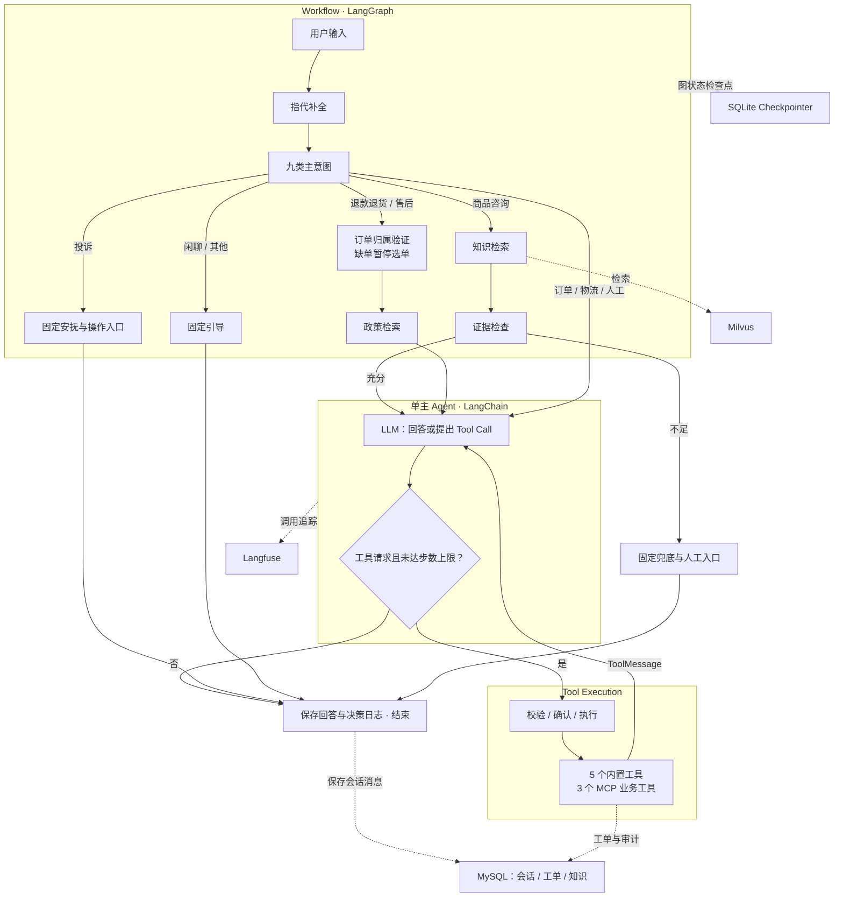

# CareMate

### Controllable Workflow-Agent for E-commerce Customer Support

**面向复杂售后业务的可控式 AI Agent 系统**

CareMate 基于 LangGraph、LangChain 与 MCP，提供知识问答、订单物流查询、退换货咨询及人工工单服务。外层确定性 Workflow 固定必要步骤，内层单主 Agent 动态组合工具；以状态保存、受控执行、证据检索和观测支撑业务处理，并通过内部评测检验检索与分层记忆设计。

[Architecture](#system-architecture) · [Engineering Highlights](#engineering-highlights) · [Evaluation](#evaluation--reproducibility) · [Live Demo](#live-demo--walkthrough) · [Quick Start](#quick-start) · [Documentation](#project-provenance--references)

## Why CareMate?

**Agent Controllability：业务检查需要落实到执行路径。** 自由工具调用可能跳过订单验证、政策检索或操作确认。系统将必经顺序固定在 LangGraph Workflow 中，让单主 Agent 在已有材料与工具回执上继续决策；写入前的确认由后端执行层控制。

**Evidence-grounded Answering：相关材料还需要覆盖问题条件。** 商品型号、政策限制和库外问题容易造成无依据回答。系统以混合检索和 Rerank 选择候选，再通过最高重排分粗筛与生成前语义检查，判断是否进入知识回答流程。

**Long-context Consistency：长期保留对象关系与历史更正。** 滑窗可能丢失早期限制，完整历史又带来成本。基础应用采用滚动摘要与滑窗；开发验证版增加 BM25 历史原文回查，补充相关问答及相邻更正。该回查方案提供实现摘录和实验报告，**完整应用接线尚未全部同步到公开 `main`**。

## System Architecture

单主 Agent 与五条确定性业务路线协作。图中实线表示请求执行，虚线表示存储或观测关联；历史原文回查属于独立标注的开发验证方案。



知识分支的两道检查在 `retrieve_knowledge` 内完成，`confidence_check` 节点留痕并通过条件边分流；退款政策分支按其自身流程处理。确定性节点也可以调用 LLM，例如政策检索前的查询扩写。

[图定义与真实边](app/graph/build.py) · [意图与停止条件](app/graph/routing.py) · [工具执行细节图](docs/engineering/tool-execution.md)

## Key Results

| Metric | Result | Scope |
| --- | ---: | --- |
| [Grouped Recall@5](docs/evaluation/rag/README.md#总体结果) | **98.4%** | Hybrid + Rerank；240 道可答题 |
| [Answer Point Coverage](docs/evaluation/rag/README.md#指标与实验边界) | **93.7%** | LLM-judged；标准答案要点覆盖 |
| [Context Task Success](docs/evaluation/context/README.md#结果) | **70/72（97.2%）** | 24 synthetic dialogues；开发验证版 |
| [Business Tools](docs/engineering/tool-execution.md#注册与发现) | **8 defined** | 5 built-in + 3 MCP；实际绑定取决于服务发现 |

- **RAG：**2026-10-11 的历史内部实验，52 个知识片段、300 题，五桶各 60；其中 240 题可答。分组 Recall 按必需证据组计算；答案覆盖由模型裁判评估，不等同于线上正确率。
- **上下文：**2026-10-27/28 的内部合成实验，24 段会话、每段三次连续追问。摘要＋滑窗为 **59/72（81.9%）**，加新回查为 **70/72（97.2%）**。
- **用量：**新回查组共 **479,290 Token**，完整历史组为 **≥641,440**，至少少 **162,150 Token**；按完整历史下界计算节省约 **25.3%**。完整历史存在缺失 usage，该比例以记录下界保守估算。两组均按报告计入维护和已记录重试。

上述效果数据来自对应版本的历史实验；8 个工具为代码定义数量。结果与当前现场 Demo 分别核验。

## Engineering Highlights

### Stateful Workflow-Agent Orchestration

**Problem：**必要业务顺序与动态工具选择需要共同存在。**Design：**外层 Workflow 将九类意图归为知识、退款售后、普通业务、投诉和闲聊／其他五条路线，内层保留 ReAct 式 Function Calling 循环。**Implementation：**`StateGraph` 定义节点与边，`ConversationState` 携带消息、订单和证据，Conditional Edge 按状态分流；主 Agent 接收 `ToolMessage` 后再决策。SQLite Checkpointer 保存图状态，`interrupt` 与 `Command(resume=...)` 支持选单、工单预览及恢复。**Evidence：**路由和确认流测试核对固定边界与恢复行为。

[图定义](app/graph/build.py) · [共享状态](app/graph/state.py) · [节点实现](app/graph/nodes.py) · [路由测试](tests/graph/test_routing.py) · [中断与恢复](docs/engineering/state-and-resume.md)

### Governed Tool Execution & Human-in-the-Loop

**Problem：**模型提出的操作需要参数、身份和副作用控制。**Design：**用 `ToolSpec` 统一内置注册与 MCP 动态发现，后端承担执行检查。**Implementation：**普通调用依次经过 **查注册表 → JSON Schema 校验 → 写操作确认检查 → 可信 `user_id`／`conversation_id` 注入 → 超时与有限重试 → 结果或错误 `ToolMessage` 回传与审计**；`create_ticket` 先暂停等待确认，取消则拒绝，写操作不自动重试。`submit_refund` 单独转为前端申请表单。**Evidence：**执行引擎测试与图确认测试覆盖非法参数、权限拒绝、超时、重试、确认及取消。

当前 `WRITE_TOOLS` 仅登记 `create_ticket`，其余已注册／发现工具默认按读处理；通用默认拒绝策略与按意图工具白名单尚未实现。Checkpointer 保存图进度，外部写操作的 Exactly-Once 仍需额外幂等机制。

[工具注册](app/tools/registry.py) · [执行引擎](app/tools/engine.py) · [执行测试](tests/tools/test_engine.py) · [确认与取消测试](tests/graph/test_ch08_confirm_ticket.py) · [执行设计](docs/engineering/tool-execution.md)

### Hybrid RAG & Evidence Reliability

**Problem：**口语语义、精确型号与政策限制需要不同检索信号。**Design：**结构感知 Chunking 保留标题、完整句重叠与表头；BGE-M3 Dense 与 Milvus BM25 Sparse 双路召回，RRF 按排名融合，再由 BGE-Reranker-v2-M3 精排。**Implementation：**Query Understanding 提供标准问法和扩展词；主知识分支以最高有效重排分粗筛，再执行生成前语义证据检查，通过后提供编号引用。未解决问题及召回快照进入归并与人工审核流程，核准后补充知识。**Evidence：**四策略对照记录检索和答案覆盖；五模型 Embedding 实验包含 BGE-large，支持当前模型选型。

最高重排分表示相关性，约 0.226 的校准阈值不代表答案正确概率。主知识分支读取动态阈值；Agent 的 `query_faq` 仍使用独立的重排阈值配置，两者的门控入口见实现说明。

[分块](app/kb/documents.py) · [检索](app/core/retrieval.py) · [评分](app/core/confidence.py) · [语义检查](app/core/selfcheck.py) · [四策略报告](docs/evaluation/rag/README.md) · [五模型报告](docs/evaluation/embedding/README.md) · [知识反馈](docs/architecture/feedback-and-classifier.md)

### Context Engineering & Memory Retrieval

**Problem：**长程指代、历史更正和多对象切换可能丢失关键关系。**Design：**Rolling Summary 保存早期背景，Sliding Window 保留近期原话，开发验证版再用 BM25-based Conversational Memory Retrieval 补充相关原句。**Implementation：**按当前会话可见历史检索正分 Top3，进行 Neighbor-turn Expansion；通过 Message-ID Deduplication 排除节点已有原文，并保留来源，形成 Source-grounded Context Assembly。**Evidence：**24 段合成会话中，任务通过由摘要＋滑窗的 81.9% 提升至 97.2%；评分同时检查对象、实际工具请求与场景限制。

公开应用已有摘要、滑窗与指代补全；新回查的算法及节点接入以开发版本摘录提供，完整依赖与应用接线尚未全部公开。该实验是内部单轮对照，完整预置历史与逐次输出仍在实验归档中。

[基础窗口](app/core/memory.py) · [滚动摘要](app/core/summarizer.py) · [版本说明](docs/architecture/context-engineering.md#版本与材料) · [回查代码摘录](docs/architecture/code-excerpts/context-recall.md) · [四方法报告](docs/evaluation/context/README.md)

## Live Demo & Walkthrough

以下为可在本地演示的四个场景。执行路径描述预期行为，现场应对照真实工具请求、回执与页面交互。详细步骤见 [Demo 指南](docs/demo/README.md)和[运行手册](docs/demo/runbook.md)。

| Demo / 测试输入 | 预期路径与观察点 | 源码入口 | 测试或运行证据 / 操作 |
| --- | --- | --- | --- |
| 商品问答与引用：`MH-LP100 的废砂盒多久倒一次？` | 知识检索 → 证据检查 → Agent；打开引用核对不同使用条件 | [retrieve_knowledge](app/graph/nodes.py) | [强制检索测试](tests/graph/test_forced_rag.py) · [引用操作](docs/demo/README.md#知识问答与后台) |
| 订单 → MCP 物流：`订单 1001 的物流到哪了？` | 主 Agent 查订单获得 tracking_no，再查物流；核对参数与实际回执 | [订单工具](app/tools/builtin/orders.py) · [物流 MCP](mcp_servers/logistics_server.py) | [MCP 适配测试](tests/tools/test_mcp_client.py) · [物流操作](docs/demo/README.md#物流工具组合) |
| 退货选单：`我要退货，但我不记得订单号了。` | fetch_order 暂停 → 本人订单选择 → resume → 政策检索 | [取单与恢复](app/graph/nodes.py) | [选单测试](tests/graph/test_ch06_nodes.py) · [选单操作](docs/demo/README.md#退货选单) |
| 工单确认／取消：`帮我建售后工单，猫砂盆漏电，需要人工处理。` | 工单预览 → 确认才写入／取消则拒绝；观察执行记录 | [agent_tools](app/graph/nodes.py) · [工单工具](app/tools/builtin/tickets.py) | [确认流测试](tests/graph/test_ch08_confirm_ticket.py) · [取消操作](docs/demo/README.md#工单确认与取消) |

订单、商品、物流及部分售后数据为模拟数据；工单写入 MySQL，退款入口登记申请，不执行资金退款。当前公开附件包括[隔离回归记录](docs/demo/assets/core-tests-20261103.md)，**尚缺本轮真实界面截图和真实模型 Trace**；取消后数据库无新增的结论需单独比对数据库记录。

## Evaluation & Reproducibility

| 实验与目标 | 数据规模与对照 | 核心结果与边界 | 报告 / 复现入口 |
| --- | --- | --- | --- |
| RAG：比较检索与回答依据 | 52 片段，300 题；向量、BM25、混合、混合＋重排 | 混合＋重排 Recall@5 98.4%，答案覆盖 93.7%；小语料、内部题集、模型裁判 | [报告与结果 JSON](docs/evaluation/rag/README.md) · [评估脚本](scripts/eval_ch04.py) |
| Embedding：比较模型选型 | 同 52 片段、300 题；M3、small、large、Qwen0.6B、Qwen4B | M3 Recall@5 98.96%；Qwen0.6B 分组排名较高。采用各模型输入前缀与维度，耗时包含服务开销 | [五模型报告](docs/evaluation/embedding/README.md) · [输入协议](docs/evaluation/embedding/protocol.json) |
| 上下文：比较连续任务与成本 | 24 段×3 问；完整历史、滑窗、摘要＋滑窗、新回查 | 新回查 70/72；内部合成、开发验证版、单轮对照；完整历史用量为下界 | [四方法报告](docs/evaluation/context/README.md) · [场景与金标](docs/evaluation/context/questions.json) |

**验证层次：**[单元测试与精选 CI](.github/workflows/ci.yml)使用 Mock／Fake Model 和隔离仓储，验证流程控制；RAG 与 Embedding 报告记录历史真实接口实验；上下文实验使用真实模型与 LangGraph/SSE、隔离数据库和业务工具；现场 Demo 则验收当前部署。四者分别记录，CI 通过不等同于真实模型任务成功。

RAG 可在准备模型与检索服务后执行评估脚本生成新报告。Embedding 保存协议与汇总，上下文保存题目目录及开发代码摘录；完整冻结向量、历史与逐次调用归档尚未全部公开，现有应用入口不保证原样复现新回查实验。日期、材料摘要与原实验版本记录见[实验目录](docs/evaluation/README.md)及[材料索引](docs/evaluation/material-index.json)。

## Quick Start

需要 **Python 3.12+、uv、Docker Compose**。以下 Make 命令还需 Make 与 Bash；Windows 可按部署文档使用 `Start-CareMate.cmd`。

```bash
uv sync
cp .env.example .env
# 编辑 .env，填写自己的模型与服务配置
docker compose up -d
make seed
make dev
```

随后按 [DEPLOY.md](DEPLOY.md) 完成知识入库、向量化及 MCP 服务准备；分类器与 Langfuse 按需单独启动。客服默认访问 `http://localhost:8000/`。端口、初始化、服务配置和故障排查统一见部署说明。

## Limitations & Roadmap

**Current Limitations**

- 当前采用单主 Agent，尚非 Multi-Agent 架构；部分业务数据为模拟数据。
- RAG 实验仅 52 个知识片段，历史内部结果的生产场景泛化尚未验证。
- BM25 会话回查的完整应用集成尚未全部公开，实验材料与公开应用需按版本区分。
- 已发现工具的副作用声明与权限白名单仍需完善；外部写操作的跨请求幂等与 Exactly-Once 尚无完整保证。
- 真实模型工具选择、数据库写入和长期运行表现需要独立验收。

**Future Work — 以下均为后续计划**

- Agent Skills 模块化封装与按需加载。
- Prompt Golden Set、版本比较与自动回归。
- 更完整的工具执行治理、显式副作用声明与权限白名单。
- 更大规模、独立题集的 RAG 质量、延迟与成本评测。
- 更完善的历史记忆、任务状态管理与应用集成。

## Project Provenance & References

CareMate 包含对已有客服工程的学习、复现与扩展。原始工程的公开再分发授权仍待核实，仓库尚未提供覆盖整个工程的根级 LICENSE；前端素材许可仅适用于对应素材。来源事实和变更材料保留在以下文档中：

- [项目来源与发布范围](docs/PROJECT-SOURCES.md)
- [变更与贡献依据](docs/CONTRIBUTIONS.md)
- [架构与实现](docs/architecture/README.md) · [工具执行](docs/engineering/tool-execution.md)
- [实验报告与问题设计](docs/evaluation/README.md)
- [框架与函数源码索引](docs/architecture/source-map.md)
