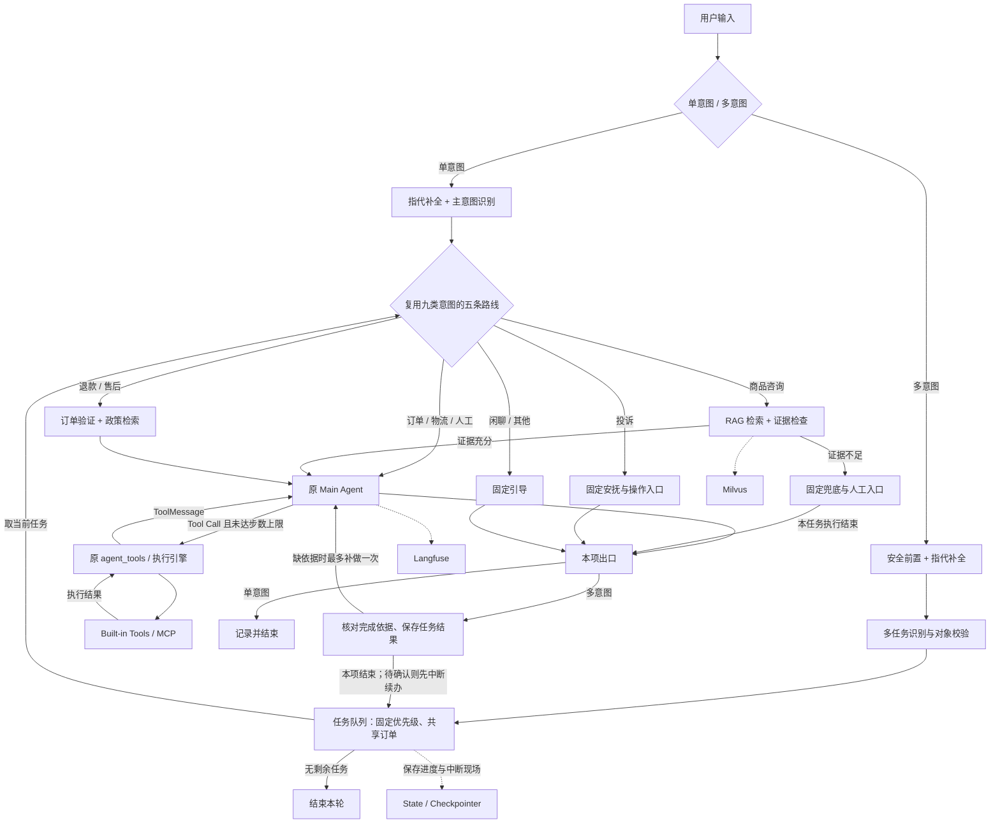

# 智能客服

面向电商售后场景的 AI Agent 工程实践项目。基于 LangGraph + LangChain + MCP，结合确定性业务工作流与单主 Agent 的动态工具调用，实现知识问答、订单物流查询、售后处理、人工确认及知识反馈。

## 01 / 项目价值

项目重点面向三个实际工程问题：

**Agent 可控执行**

对于订单归属、政策检索和工单创建等操作，不能完全依赖模型自主规划。系统采用确定性 Workflow + 单主 Agent 的混合架构，将必要步骤放入 LangGraph，将动态工具组合交给模型，并由后端校验和授权执行。

**可靠的知识增强问答**

电商客服同时面临口语表达、精确商品型号及复杂政策条件。系统构建 Dense + BM25 混合检索，通过 RRF 融合、Cross-Encoder Rerank 和生成前证据充分性检查，降低缺乏依据的回答进入生成流程的风险。

**长对话上下文管理**

针对历史订单更正、远距离指代与多对象切换，系统采用滚动摘要和近期原文窗口；本分支已接入基于 BM25 的历史会话原文回查，辅助恢复关键历史依据，相关实验仍按各自冻结版本报告。

此外，系统包含统一工具注册与执行引擎、状态持久化与人工确认、Langfuse 运行追踪及人工审核驱动的知识更新。

本分支在上述能力上增加**多意图任务调度**：将复合请求拆成任务，按固定优先级复用原业务流程，保存当前与剩余事项，支持选单、确认后的顺序续办。

## 02 / 系统架构

系统采用 **Workflow + Single-Agent** 混合架构：

- 确定性 Workflow 保证必要业务顺序。
- 多意图模式增加任务队列、共享订单与完成检查，仍使用原 `main_agent` 和 `agent_tools`；关闭时走单意图路径。
- Agent 通过 Function Calling 产生结构化工具请求，后端执行后将结果封装为 ToolMessage，再交给模型继续判断，形成一个 ReAct 式工具循环。



## 从这里阅读

按“流程 → 多意图调度 → 知识检索 → 上下文 → 知识反馈”了解系统；各模块都提供源码入口和相关结果。

| 顺序 | 内容 | 入口 |
| --- | --- | --- |
| 1 | Workflow、四个组件与工具执行 | [架构详解](docs/architecture/workflow-and-agent.md) · [源码索引](docs/architecture/source-map.md) |
| 2 | 任务拆分、优先级调度、共享订单与中断续办 | [多意图调度器设计](docs/architecture/multi-intent-scheduler.md) |
| 3 | 知识存储、分块、Embedding 选型与混合检索 | [RAG 与证据评估](docs/architecture/rag-and-confidence.md) |
| 4 | 滚动摘要、滑窗、原文回查及连续任务 | [上下文工程](docs/architecture/context-engineering.md) |
| 5 | 问题归并、人工核准与主题分类 | [知识反馈](docs/architecture/feedback-and-classifier.md) |
| 6 | 实验结果、问题设计与统计方法 | [实验与评估](docs/evaluation/README.md) |
| 7 | 环境准备与功能页面 | [部署说明](https://github.com/Orange-ui0811/caremate/blob/main/DEPLOY.md) · [模块导航](docs/architecture/README.md) |

## 系统做什么

- **Workflow 与 Agent：**九类意图映射到五条路线，知识咨询先检索，退款/售后先确定订单并获取政策，再进入主 Agent；模型通过工具结果逐步决定下一步。
- **多意图调度：**在原流程外增加任务列表与串行循环，同组共享已核验订单；选单或确认时保留剩余任务，恢复后按回执更新状态，继续未完成事项，不因拆分任务降低提交确认要求。
- **RAG：**组合向量与 BM25 检索、RRF 融合、重排和查询改写；知识分支使用候选最高重排分粗筛与生成前语义自检，返回带编号的证据引用。
- **工具执行：**统一注册本地与 MCP 工具，执行参数校验、可信参数注入、超时和有限重试；创建工单需要用户确认。
- **上下文与交互：**滚动摘要、近期原文滑窗与相关原文回查协同处理多轮问题，结合指代补全、SSE 和暂停恢复；实现与版本对应见[上下文工程](docs/architecture/context-engineering.md)。
- **知识反馈：**将未解决问题与可获得的检索快照归集到待审流程，人工审核后补充知识；17 类主题分类器用于旁路归类，不代替在线九类意图识别。
- **运行观测：**接入 Langfuse，按会话与意图追踪执行并统计 Token。金额分析需要正确的模型价格和用量口径。

## 架构分工

| 层 | 技术与职责 | 核心代码 |
| --- | --- | --- |
| HTTP 与流式交互 | FastAPI、SSE | [app/api](app/api)、[runtime.py](app/graph/runtime.py) |
| 业务编排 | LangGraph 状态、分支、检查点与暂停恢复 | [build.py](app/graph/build.py)、[state.py](app/graph/state.py) |
| 多意图调度 | 任务识别、固定优先级、共享对象、完成依据与续办 | [task_queue.py](app/graph/task_queue.py)、[queue_contract.py](app/graph/queue_contract.py) |
| 模型交互 | LangChain 提示词、模型、结构化输出、工具消息 | [llm.py](app/core/llm.py)、[prompts.py](app/core/prompts.py) |
| Agent 循环 | 主模型决策 → 工具执行 → 结果回传 → 再决策 | [nodes.py](app/graph/nodes.py)、[routing.py](app/graph/routing.py) |
| 工具接入 | 内置工具、MCP 动态发现、统一执行引擎 | [app/tools](app/tools)、[mcp_servers](mcp_servers) |
| 检索与存储 | Milvus、MySQL、SQLite 检查点 | [retrieval.py](app/core/retrieval.py)、[app/db](app/db) |
| 观测 | Langfuse 回调、意图标签与 Token 报表 | [observability.py](app/core/observability.py)、[cost_by_intent.py](scripts/cost_by_intent.py) |

### 五条处理路线

单意图的公共前置步骤是“用户问题 → 指代补全 → 意图识别”；多意图先形成任务队列，每个任务仍复用下列路线。缺订单时复用原选单机制；一般投诉与明确登记工单的办理请求按原规则区分。

| 意图 | 后续处理 |
| --- | --- |
| 商品咨询 | 知识检索 → 证据判断 → 主 Agent 或固定兜底 |
| 退款退货、售后 | 确定订单 → 检索政策 → 主 Agent |
| 订单、物流、人工 | 主 Agent 按需选择工具 |
| 投诉 | 固定安抚与后续操作入口 |
| 闲聊、其他 | 固定引导话术 |

主 Agent 通过 Function Calling 提出行动请求，后端执行后将结果写成 ToolMessage，再请求模型继续处理。没有工具请求或达到步数上限时结束。该循环由一个主 Agent 执行，以结构化工具请求驱动。

### 八个业务工具

| 来源 | 工具 |
| --- | --- |
| 内置 | `query_order`、`query_product`、`query_faq`、`submit_refund`、`create_ticket` |
| 物流 MCP 服务 | `query_logistics` |
| 售后 MCP 服务 | `query_warranty`、`query_return_status` |

实际绑定数量取决于当时 MCP 服务的发现结果。`submit_refund` 在图中转换为前端表单；`create_ticket` 确认后写入 MySQL。

## 本地运行

需要 Python 3.12+（可由 uv 管理）、uv、Docker Compose。Makefile 工作流还需要 Make 与 Bash；Windows 可使用 Git for Windows、GNU Make 和项目启动脚本。模型聊天、嵌入、重排服务分别在配置中设置。

1. 复制 `.env.example` 为 `.env`，填写自己的服务配置。
2. 依照 [DEPLOY.md](https://github.com/Orange-ui0811/caremate/blob/main/DEPLOY.md) 安装依赖、启动容器并初始化业务与知识数据。
3. Windows 可运行 `Start-CareMate.cmd`；使用 Make 的环境可运行下面的基础启动命令。

```bash
uv sync
cp .env.example .env
# 编辑 .env 后再启动
docker compose up -d
make seed
make dev
```

基础服务启动后，按部署说明继续完成知识入库和向量化；主题分类功能还需准备分类器权重与推理服务。

| 页面/服务 | 默认本机地址 |
| --- | --- |
| 客服聊天 | http://localhost:8000/ |
| 管理入口 | http://localhost:8000/admin |
| 知识库 | http://localhost:8000/kb |
| 待审队列 | http://localhost:8000/review |
| 观测与成本 | http://localhost:8000/observability |
| 主题分类验收 | http://localhost:8000/acceptance |
| Langfuse（单独启动） | http://localhost:3000/ |

上表为本机运行地址。Compose 提供开发环境，外部部署的凭据、鉴权与网络设置见部署说明。

## 实验结果与问题设计

| 实验 | 固定数据与比较范围 | 报告 |
| --- | --- | --- |
| RAG 四策略 | 300 题、五桶；240 可答题的检索、证据与答案覆盖 | [四策略结果与五桶设计](docs/evaluation/rag/README.md) |
| 五模型 Embedding | 同 52 知识片段和 300 题；纯向量精确余弦排序 | [模型、维度、输入协议与分桶结果](docs/evaluation/embedding/README.md) |
| 上下文四方法 | 同 24 段合成会话，每段三次连续追问；含维护成本 | [四方法对照与测试场景](docs/evaluation/context/README.md) |
| 多意图调度 | 150 个业务场景、五桶各30题，每版一次；复用基线轨迹统一评分 | [版本、结果与统计口径](docs/architecture/multi-intent-scheduler.md#multi-evaluation) |

各报告分别记录实验日期、数据规模、输入协议与统计范围；结果来自对应版本的内部实验。上下文用量缺失的记录以总 Token 下界表示。多意图150题结果对应冻结版本 `91dd05b`，后续补丁只做专项验证，不混用为最新版本的全量成绩。

## 验证与结果口径

```bash
make test
make help
```

`make test` 执行项目测试；真实模型、检索与分类器评估另有前置条件，参见部署说明和架构文档。测试运行与真实服务验收分开记录，具体环境和检查范围以运行结果为准。

固定问集、方法对照和统计定义统一收录在[实验与评估](docs/evaluation/README.md)。

## 目录

```text
app/api/          HTTP 与 SSE 接口
app/graph/        状态、节点、路由和图运行
app/core/         模型、检索、上下文、反馈与观测
app/tools/        工具注册、实现、MCP 客户端与执行引擎
app/db/           数据模型与仓储
app/static/       客服与管理页面
mcp_servers/      独立物流和售后服务
scripts/          初始化、评估、训练与报表
sql/              数据库初始化与迁移
tests/            测试与测试数据
docs/architecture/   架构说明及源码索引
```


## 代码与数据

仓库提供应用基础源码、前端、MCP 服务、部署脚本、测试与示例知识，以及实验汇总和合成题目设计。运行配置、业务数据库与训练权重由使用者准备。本分支提供历史原文回查与共享 Agent 多意图调度实现；当前设计及版本边界见[多意图调度器设计](docs/architecture/multi-intent-scheduler.md)。

定位实现可使用 [框架源码索引](docs/architecture/source-map.md)，该页面直接链接仓库中的实际函数。
