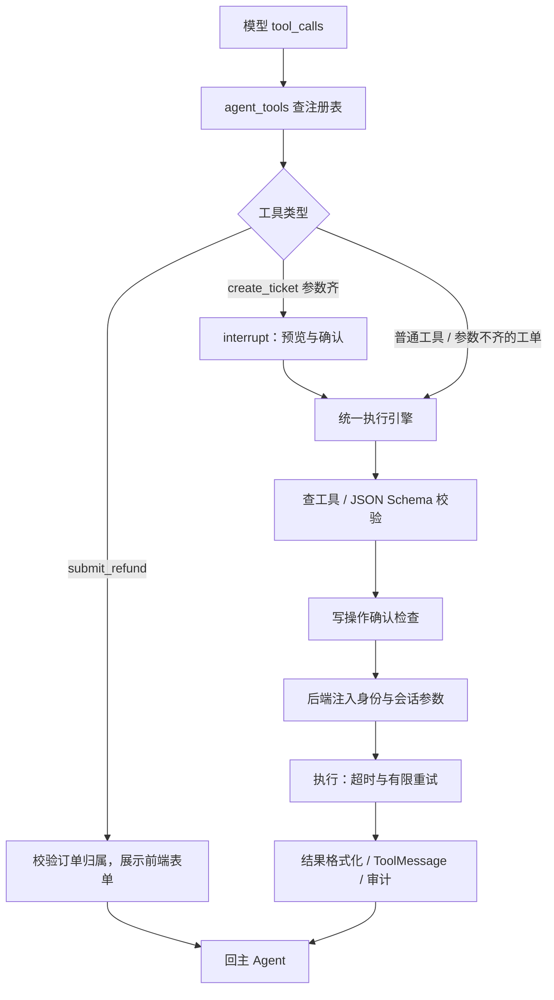

# 工具注册与执行控制

模型通过 function calling 提出工具名和参数，后端决定如何校验、确认与执行。实现入口：[registry.py](../../app/tools/registry.py)、[engine.py](../../app/tools/engine.py)、[agent_tools](../../app/graph/nodes.py)。

## 注册与发现

ToolSpec 保存名称、描述、模型可见 JSON Schema、实现、来源、权限、超时与重试覆盖项。启动扫描 builtin 包注册 5 个工具；MultiServerMCPClient 通过 streamable HTTP 从物流和售后服务动态获取 3 个工具。重名时内置工具优先，服务不可达时跳过其工具。

main_agent 将合并清单交给 bind_tools。当前全部可用业务工具共同绑定，未实现按意图的工具白名单。意图识别用 with_structured_output(_Intent, method="function_calling") 接收分类字段，属于另一次模型调用；它不进入业务工具注册表。

## 执行顺序

submit_refund 是前端表单分支，不经过普通执行引擎。create_ticket 的参数预检在 interrupt 之前，统一引擎执行时仍会校验。

| 控制项 | 当前行为 | 验证入口 |
| --- | --- | --- |
| 参数校验 | JSON Schema 拦截非法参数并回灌错误 | [test_engine.py](../../tests/tools/test_engine.py) |
| 身份注入 | user_id / conversation_id 使用后端可信值；模型可见 Schema 排除注入参数 | [订单归属测试](../../tests/tools/test_order_ownership.py) |
| 写操作确认 | create_ticket 是当前写清单成员；未确认则拒绝执行 | [确认流测试](../../tests/graph/test_ch08_confirm_ticket.py) |
| 查询重试 | 仅网络或超时等暂时故障有限重试；业务异常不重试 | [执行引擎测试](../../tests/tools/test_engine.py) |
| 写操作重试 | 写工具不自动重试；超时仍可能已产生副作用 | [执行引擎测试](../../tests/tools/test_engine.py) |
| 知识检索工具 | query_faq 超时 30 秒，执行层重试次数 0 | [faq.py](../../app/tools/builtin/faq.py) |
| 结果回传 | ToolMessage.tool_call_id 对应请求；MCP 结果挑字段、翻译枚举 | [MCP 客户端测试](../../tests/tools/test_mcp_client.py) |

## 扩展边界

WRITE_TOOLS 当前只有 create_ticket。其余新发现工具默认按读处理，因此接入新的有副作用 MCP 工具之前，必须扩展权限声明与执行策略。未知名称在执行时被拒绝，与“已发现但未标写的新工具”是两种情况。

当前测试覆盖确认、取消、参数缺失、单次多工单及错误形状恢复值。尚未实现跨进程、网络重放和崩溃窗口下的完整写入幂等保证。状态暂停恢复见[中断与恢复](state-and-resume.md)。
